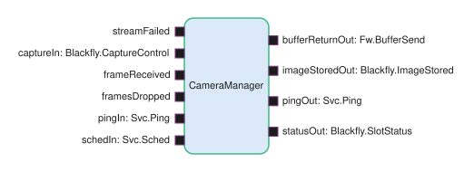
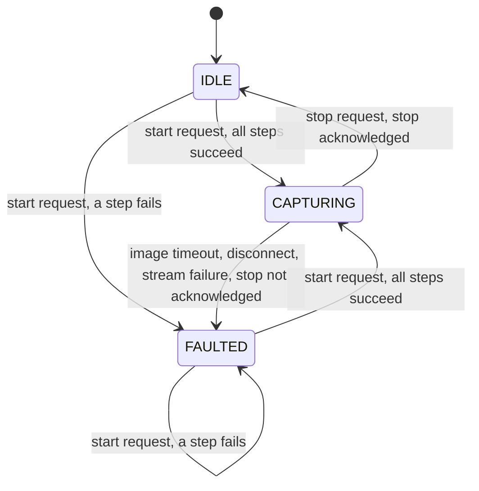
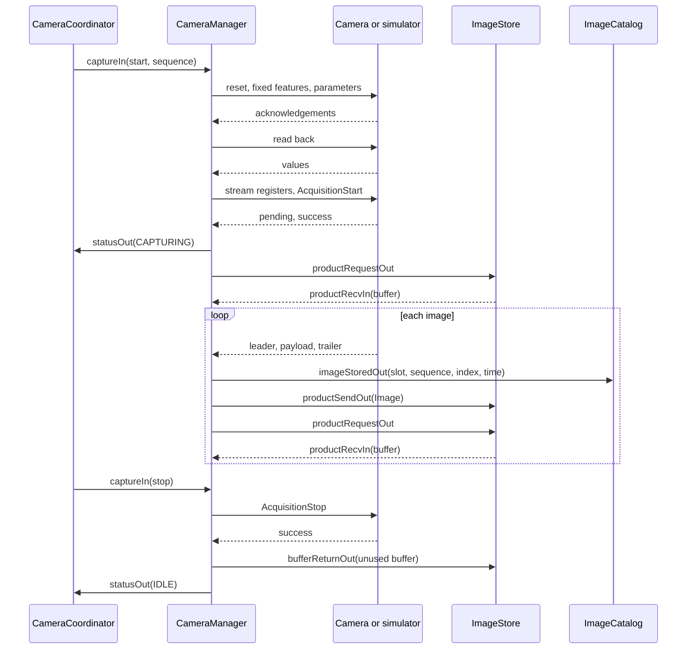

# Blackfly::CameraManager

## 1. Introduction

CameraManager is an active F Prime component that operates one FLIR Blackfly S BFS-U3-244S8C
camera for one camera slot. It reaches the camera through a transport chosen at startup: USB3
(`libusb`) for a camera, or a local socket for a camera simulator that speaks the same USB3
Vision bytes. On a capture start request it writes its parameters to the camera, reads the
camera's values back into telemetry, and starts acquisition. Each image that arrives becomes one
RAW data product with the slot, sequence, image index and capture time. It reports the slot
idle, capturing or faulted. A fault stops the slot's capture until the next capture start
request. It keeps a trace of the control exchanges that a command writes to a file.
Device identity: the bench camera of slot 0 is serial 26247528 (USB `01908168`), firmware
2103.0.628.0, GenCP 1.0, USB3 Vision 1.0, model name `Blackfly S BFS-U3-244S8C`; its device
description is the one named in External References (bootstrap read `02-bootstrap-01908168`).

## 2. Requirements

| ID | Requirement | Verification | Traces to |
|---|---|---|---|
| REQ-CamMgr-001 | The component shall control its camera through the USB3 or socket transport configured at startup. | Unit Test, Integration Test | REQ-LDC-002, REQ-LDC-028 |
| REQ-CamMgr-002 | The component shall send GenCP 1.0 ReadMem and WriteMem commands and accept USB3 Vision 1.0 image leaders, payloads and trailers. | Unit Test, Integration Test | REQ-LDC-003, REQ-LDC-028, REQ-LDC-029 |
| REQ-CamMgr-003 | Feature register addresses shall equal those of the BFS-U3-244S8C device description, SHA-256 `9be43bbd…ffd4ad`. | Unit Test, Inspection | REQ-LDC-004 |
| REQ-CamMgr-004 | A camera whose identity differs from the Camera identity table shall fault the slot with a `WARNING_HI` event. | Unit Test | REQ-LDC-004 |
| REQ-CamMgr-005 | The component shall have the parameters of the Parameters table. | Unit Test | REQ-LDC-005, REQ-LDC-006 |
| REQ-CamMgr-006 | Each capture start shall write every parameter that holds a value to the camera. | Unit Test, Integration Test | REQ-LDC-006, REQ-LDC-009 |
| REQ-CamMgr-007 | A parameter set during a capture sequence shall reach the camera at the next capture start. | Unit Test, Integration Test | REQ-LDC-077 |
| REQ-CamMgr-008 | After each capture start, telemetry shall report the camera's read-back value of every Parameters table feature. | Unit Test, Integration Test | REQ-LDC-007 |
| REQ-CamMgr-009 | A parameter write not acknowledged with success shall fault the slot with a `WARNING_HI` event. | Unit Test | REQ-LDC-008 |
| REQ-CamMgr-010 | A capture start that faults the slot shall start no acquisition and store no image. | Unit Test | REQ-LDC-008 |
| REQ-CamMgr-011 | A parameter whose feature the camera reports locked or unavailable shall be skipped and counted in telemetry. | Unit Test | REQ-LDC-008 |
| REQ-CamMgr-012 | A capture start request shall start image acquisition and report the slot capturing. | Unit Test, Integration Test | REQ-LDC-001, REQ-LDC-015, REQ-LDC-017 |
| REQ-CamMgr-013 | A capture stop request shall end acquisition and report the slot idle. | Unit Test, Integration Test | REQ-LDC-016 |
| REQ-CamMgr-014 | A capture start request during capture shall be ignored with a `WARNING_LO` event. | Unit Test | REQ-LDC-015 |
| REQ-CamMgr-015 | A capture stop request while not capturing shall leave the slot state unchanged. | Unit Test | REQ-LDC-016, REQ-LDC-026 |
| REQ-CamMgr-016 | The component shall report its slot state, idle, capturing or faulted, at each change. | Unit Test, Integration Test | REQ-LDC-021 |
| REQ-CamMgr-017 | A capture start not acknowledged with success within `ACK_TIMEOUT` shall fault the slot with a `WARNING_HI` event. | Unit Test, Integration Test | REQ-LDC-022 |
| REQ-CamMgr-018 | A capturing slot receiving no image for `IMAGE_TIMEOUT`, counted in scheduler ticks, shall become faulted with a `WARNING_HI` event. | Unit Test, Integration Test | REQ-LDC-023 |
| REQ-CamMgr-019 | A transport disconnect or read error during capture shall fault the slot with a `WARNING_HI` event. | Unit Test, Integration Test | REQ-LDC-024 |
| REQ-CamMgr-020 | A camera that cannot be opened at capture start shall fault the slot with a `WARNING_HI` event. | Unit Test | REQ-LDC-026 |
| REQ-CamMgr-021 | A faulted slot shall stay faulted until a capture start request, which tries the camera again. | Unit Test, Integration Test | REQ-LDC-026 |
| REQ-CamMgr-022 | Each image received complete shall be handed to storage as one RAW data product. | Unit Test, Integration Test | REQ-LDC-001, REQ-LDC-033 |
| REQ-CamMgr-023 | Each image product shall hold the camera's pixel bytes unchanged. | Unit Test, Integration Test | REQ-LDC-033 |
| REQ-CamMgr-024 | Each image product shall record the metadata of the Image metadata table. | Unit Test | REQ-LDC-034 |
| REQ-CamMgr-025 | Capture time shall be the system time read when the image's trailer arrives. | Unit Test | REQ-LDC-034 |
| REQ-CamMgr-026 | Each sequence's image index shall start at zero and increase by one per product handed to storage. | Unit Test | REQ-LDC-036 |
| REQ-CamMgr-027 | An image whose leader or trailer differs from the read-back image size shall be discarded and counted in telemetry. | Unit Test | REQ-LDC-027 |
| REQ-CamMgr-028 | An image arriving while no image buffer is available shall be dropped and counted in telemetry. | Unit Test | REQ-LDC-041 |
| REQ-CamMgr-029 | A refused image buffer request shall be repeated at the next scheduler tick, capture continuing. | Unit Test | REQ-LDC-040, REQ-LDC-041 |
| REQ-CamMgr-030 | Before handing over each product, the component shall send its slot, sequence, index and capture time. | Unit Test | REQ-LDC-033, REQ-LDC-040 |
| REQ-CamMgr-031 | The component shall record command, address, status and length of the first 1024 control exchanges since the capture start request. | Unit Test | REQ-LDC-003, REQ-LDC-029 |
| REQ-CamMgr-032 | The `DUMP_CONTROL_TRACE` command shall write the recorded control exchanges to a file. | Unit Test, Integration Test | REQ-LDC-003, REQ-LDC-029 |
| REQ-CamMgr-033 | A control trace file that cannot be written shall fail the command with a `WARNING_HI` event. | Unit Test | REQ-LDC-029 |
| REQ-CamMgr-034 | While no image is dropped, stored image rate shall equal `FRAME_RATE` within 5 percent over 60 s. | Integration Test | REQ-LDC-009 |
| REQ-CamMgr-035 | Frames missing from the camera's block ID sequence shall be counted in telemetry. | Unit Test | REQ-LDC-009 |
| REQ-CamMgr-036 | An acknowledgement whose request ID or command differs from the command sent shall not complete the exchange. | Unit Test | REQ-LDC-003 |
| REQ-CamMgr-037 | A stream transfer that is not the expected leader or trailer shall fault the slot with a `WARNING_HI` event. | Unit Test | REQ-LDC-003, REQ-LDC-027 |
| REQ-CamMgr-038 | From startup until the first capture start request, the slot shall be idle and send the camera nothing. | Unit Test | REQ-LDC-017 |
| REQ-CamMgr-039 | Each capture start shall first stop any acquisition the camera has running. | Unit Test | REQ-LDC-017 |
| REQ-CamMgr-040 | A failed control exchange of a capture start, other than a parameter write or `AcquisitionStart`, shall fault the slot with a `WARNING_HI` event. | Unit Test | REQ-LDC-003, REQ-LDC-026 |
| REQ-CamMgr-041 | A capture stop the camera does not acknowledge with success shall fault the slot with a `WARNING_HI` event. | Unit Test | REQ-LDC-016 |
| REQ-CamMgr-042 | The component's code shall allocate no memory after startup configuration. | Inspection | request: "no allocation after initialization" |
| REQ-CamMgr-043 | A capture stop request shall be answered with an idle or faulted report within `ACK_TIMEOUT` plus 500 ms. | Integration Test, Unit Test | REQ-LDC-016 |
| REQ-CamMgr-044 | A scheduler tick arriving at a full queue shall be dropped, capture continuing. | Unit Test | REQ-LDC-023 |

`Integration Test` is a system test of the LDC deployment plan (section 9). `Unit Test` is a test of section 8.

### External References

| Document | Identifier / Revision | Type | Governs |
|---|---|---|---|
| USB3 Vision specification | AIA USB3 Vision 1.0 | Standard | bootstrap registers, control and stream framing |
| GenICam Generic Control Protocol | EMVA GenCP 1.0 | Standard | control messages, acknowledge statuses |
| BFS-U3-244S8C GenICam device description | XML model `BFS_U3_244S8`, schema 1.1, SHA-256 `9be43bbdcd76435a93e9dce4dd64e3535f0889b56e96095d0007616f98ffd4ad`; delivered by the camera as a zip of 67623 bytes, SHA-1 `ad4370397be7c60b6c00af21b3baa24054daebf1`; never committed | ICD | register addresses, types, ranges, conversions |
| Blackfly S BFS-U3-244S8 technical reference | Teledyne FLIR, revised 11/17/2022, SHA-256 `55eb792110512c0499a7568928c8b1afdb6a61b494dedc299c046d104dcb4d64`; never committed | Datasheet | feature meanings |
| Blackfly S pathfinder report and traces | lestarch-autobot/fprime-devices `blackfly-pathfinder` @ ad7ce9f, `Blackfly/pathfinder/REPORT.md`, `truth/`, `genicam/` | Other | measured behaviour of camera 01908168 |
| CameraSimulator socket protocol | lestarch-autobot/fprime-devices `campaign/CamSim` @ 1dcfe67, `Blackfly/CameraSimulator/docs/sdd.md`, "Socket protocol" | ICD | socket transport records |
| F Prime data product container | nasa/fprime `devel` @ 433db6e, `Fw/Dp/docs/sdd.md` | ICD | product file format |
| LDC system design and plan | lestarch-autobot/ldc-project `devel` @ aa3b9df, `docs/ssdd.md`, `test/system/plan.md` | Other | parent requirements, system tests |
| `libusb` | 1.0.27 (Ubuntu 24.04 package `libusb-1.0-0` 2:1.0.27-1) | Other | USB3 transport calls |
| F Prime C++ design rules | lestarch-autobot/fprime `system-campaign-skills` @ d488d24, `.github/skills/fprime-cpp-design/SKILL.md` | Standard | coding rules |

## 3. Design

### 3.1 Component Diagram



Special ports: command receive, registration and response; event and text event; telemetry; time get; parameter get and set.

### 3.2 Layers

| Layer | Does |
|---|---|
| `CameraManager` (component) | slot state, parameters, capture start and stop, image products, telemetry, events |
| `GenCpControl` | one control exchange: command framing, request ID, pending acknowledgements, `ACK_TIMEOUT` budget, control trace |
| `StreamReader` | one task: leader, payload, trailer; checks; hands frames to the component |
| `RegisterTable` | static table generated from the device description at development time: address, length, conversion, limit and flag registers, enumeration values |
| `CameraTransport` (interface) | carries the USB3 Vision bytes; implemented by `UsbTransport` (`libusb`) and `SocketTransport` |

GenCP framing and the stream state machine sit above the transport, so both transports run the same code.

The stream reader is a task of its own (`Os::Task`), as in the F Prime byte-stream drivers (`Drv.LinuxUartDriver`, `Drv.TcpClient`): a stream read blocks for up to 100 ms and moves 24.5 MB per image, which the component thread cannot do while it serves requests, ticks and pings. The reader talks to the component through the three internal ports. The only shared data is the `m_reader` record, held under one `Os::Mutex` with one `Os::ConditionVariable`; a guarded port cannot be used because the reader must wait for a buffer with a time limit. The reader never holds the mutex during a transport call or a port call.

Framework facilities used: `Os::Task`, `Os::Mutex`, `Os::ConditionVariable`, `Os::File` (trace file), `Fw::DpContainer`. `Drv/Ip` is not used for the socket transport: it serves TCP and UDP, not Unix stream sockets.

| `CameraTransport` operation | `UsbTransport` | `SocketTransport` |
|---|---|---|
| `open()`, `close()` | find `1e10:4000` by serial string, claim interfaces 0 to 2 | connect to the socket path, read the HELLO record |
| `controlWrite(bytes, length)` | bulk OUT 0x02 | one DATA record, control channel |
| `controlRead(buffer, capacity, timeoutMs)` gives length and time waited | bulk IN 0x82, capacity is the maximum acknowledgement length | one DATA record, control channel |
| `streamRead(buffer, length, timeoutMs)` gives length | bulk IN 0x81, one transfer | one DATA record, stream channel |
| `streamReadPayload(buffer, transferSize, count, final1, final2, timeoutMs)` gives length | queued bulk IN transfers into consecutive parts of the buffer | one DATA record per transfer |
| `streamReset()` | cancel transfers, clear halt on 0x81 | one RESET record, stream channel |
| `info()` | USB serial string, speed | HELLO text |

Every operation returns a status: success, timeout, error or disconnected. Every wait has a time limit: `open()` waits at most 1 s for the HELLO record. `streamReset()` may be called from the component thread while the reader is in a stream read; that read then returns with a timeout status. `close()` is called only after the reader has parked. The event channel is claimed and not read.

The socket carries control and stream records on one connection, and the component thread and the reader both read it. `SocketTransport` reads records under a read lock, held for one poll of at most 10 ms at a time so that neither thread delays the other by more. A record for the other channel is put in that channel's holding area (1024 bytes for control, 1 MiB for stream, one record each); a reader that finds the other holding area full waits, within its own time limit, for it to be taken. While the reader's stop flag is set or the reader is parked, a stream record met by a control read is discarded, so a stop is never held up by frames still arriving. Writes are under a write lock. `UsbTransport` needs neither: each endpoint has one reader.

The socket record format is that of the CameraSimulator socket protocol (External References).

### 3.3 Ports

| Name | Kind | Type | Purpose |
|---|---|---|---|
| `captureIn` | async input | `Blackfly.CaptureControl` | capture start and stop request |
| `statusOut` | output | `Blackfly.SlotStatus` | slot state at each change |
| `imageStoredOut` | output | `Blackfly.ImageStored` | notice sent before each product |
| `schedIn` | async input, drop | `Svc.Sched` | tick: image timeout, buffer retry, telemetry |
| `pingIn`, `pingOut` | async input, output | `Svc.Ping` | health ping |
| `productRequestOut` | product request | — | ask for an image buffer |
| `productRecvIn` | async product receive | — | image buffer or refusal |
| `productSendOut` | product send | — | image product |
| `bufferReturnOut` | output | `Fw.BufferSend` | return a buffer that holds no product |
| `frameReceived` | internal, block | — | stream reader: a frame is complete or discarded |
| `framesDropped` | internal, drop | — | stream reader: frames read with no buffer |
| `streamFailed` | internal, block | — | stream reader: stream ended |

A full queue drops a tick and a drop report (the count stays with the reader and is sent again); it blocks the stream reader on `frameReceived` and `streamFailed`; it asserts on `captureIn`, `pingIn`, `productRecvIn` and the command.

### 3.4 State

| Member | Values | Meaning |
|---|---|---|
| `m_state` | `IDLE`, `CAPTURING`, `FAULTED` | slot state |
| `m_sequence` | U32 | sequence number of the current or last capture |
| `m_imageIndex` | U32 | index of the next product in the sequence |
| `m_ticksSinceImage` | U32 | ticks since capture start or the last frame |
| `m_bufferRequested` | bool | an image buffer request is unanswered |
| `m_frame` | geometry, pixel format, payload size | values read back at capture start that every frame must match |
| `m_counters` | U32 each | dropped, discarded, missed frames, locked parameters |
| `m_trace` | 1024 entries, count | control exchanges since capture start |
| `m_reader` | parked, reading, armed buffer, stop flag | shared with the stream reader under one mutex and condition variable |



### 3.5 Configuration and Setup

```fpp
constant FeatureNameSize = 48
```
Size of a camera feature name in an event.

```cpp
// CameraManagerCfg.hpp
static constexpr U32 CONTROL_TRACE_CAPACITY = 1024;        // exchanges kept
static constexpr U32 PAYLOAD_TRANSFER_SIZE = 1048576;      // bytes per payload transfer
static constexpr U32 MAX_PENDING_ACKS = 32;                // per control exchange
static constexpr U32 MAX_IGNORED_ACKS = 8;                 // per control exchange
static constexpr U32 BUFFER_WAIT_MS = 50;                  // reader wait for an image buffer
static constexpr U32 STREAM_POLL_MS = 100;                 // reader wait for a leader, payload part or trailer
static constexpr U32 START_BUDGET_MS = 10000;              // transport waits of one capture start
static constexpr U32 READER_PARK_MS = 300;                 // wait for the reader to park
```

```cpp
camera0.configure(0, Blackfly::Backend::USB3, "01908168", traceDirectory, tickPeriodMs);
camera1.configure(1, Blackfly::Backend::SOCKET, "/tmp/blackfly-camsim-1.sock", traceDirectory, tickPeriodMs);
```
Slot, transport, device (USB serial string or socket path), directory of the control trace files, period of `schedIn`. `configure` takes all memory and starts the stream reader task, parked.

```fpp
instance camera0: Blackfly.CameraManager base id 0x20000000 queue size 30 stack size Default.STACK_SIZE priority 100
```

### 3.6 Port Handlers

**`captureIn`, start.** Admitted when the state is `IDLE` or `FAULTED`; while `CAPTURING` it raises `CaptureStartIgnored`. It runs the capture start steps below in order on the component thread; the first failure closes the transport, raises that step's event and reports `FAULTED`, and success reports `CAPTURING` with `CaptureStarted`.

**`captureIn`, stop.** Admitted when the state is `CAPTURING`; otherwise it raises `CaptureStopIgnored` and changes nothing. It sets the reader's stop flag, writes `AcquisitionStop`, calls `streamReset()`, waits up to 300 ms for the reader to park, returns an unused buffer, and reports `IDLE` with `CaptureStopped`; a stop not acknowledged, or a reader not parked in time, closes the transport and reports `FAULTED` with `CaptureStopFailed`.

**`frameReceived`.** Admitted when capturing and the frame's `sequence` argument is current. A good frame gets its metadata record, is announced on `imageStoredOut`, sent on `productSendOut` and counted, and the next buffer is requested; a discarded frame is counted, raises `ImageDiscarded`, and its buffer is armed again.

**`framesDropped`, `streamFailed`.** `framesDropped` adds to the drop count and raises `ImagesDroppedNoBuffer`. `streamFailed` while capturing with the current `sequence` parks the reader, closes the transport and reports `FAULTED` with `CameraDisconnected` or `StreamFailed`.

**`productRecvIn`.** A buffer that arrives while capturing and holds the current payload size is armed for the reader; any other is returned on `bufferReturnOut`. A refusal clears `m_bufferRequested`, so the next tick asks again.

**`schedIn`.** While capturing it counts the tick, raises `ImageTimeout` and faults the slot when the count reaches `IMAGE_TIMEOUT` divided by the tick period, rounded up, and asks for a buffer when none is armed or requested. It writes the changed telemetry channels.

**`DUMP_CONTROL_TRACE`.** Admitted in every state. It writes the trace to `ControlTrace_slot<N>_seq<S>.txt` in the trace directory, one line per exchange, and raises `ControlTraceDumped`, or fails the command with `ControlTraceDumpFailed`.

**`pingIn`.** Returns the key on `pingOut`.

### 3.7 Capture start steps

| Step | Exchanges | Failure event |
|---|---|---|
| `OPEN` | open the transport, when it is not open | `CameraOpenFailed` |
| `BOOTSTRAP` | read the Camera identity registers one at a time, when the transport was just opened | `CameraIdentityMismatch`, `ControlFailed` |
| `RESET` | write `AcquisitionStop`, clear the stream enable bit, `streamReset()` | `ControlFailed` |
| `FIXED` | write `AcquisitionMode` Continuous, `ChunkModeActive` off, `TransferControlMode` Basic | `ControlFailed` |
| `PARAMETERS` | for each parameter that holds a value, in Parameters table order: read the feature's flag register, then write the value unless locked or unavailable | `ParameterRefused` |
| `READ_BACK` | read every Parameters table feature the flag register reports available, `PayloadSize` and `AcquisitionResultingFrameRate`, and write the channels | `ControlFailed` |
| `STREAM` | write the stream interface registers for `PayloadSize` in 1 MiB transfers, set the stream enable bit | `ControlFailed` |
| `START` | clear the counters of the sequence, release the reader, write `AcquisitionStart` | `CaptureStartNotAcknowledged` |

- A parameter holds a value when it has a default or was set by command or loaded from the parameter database. A parameter set while capturing is only stored.
- When `WIDTH` or `HEIGHT` is written, `OffsetX` and `OffsetY` are written to 0 first. The rate parameters are last because their limits depend on the others.
- Parameter values are converted with the register table: identity, linear, fixed point, reciprocal, enumeration entry. Read-back uses the same table in reverse.
- One control exchange: write the command, then read acknowledgements. A pending acknowledgement continues the wait. The exchange ends as `TIMEOUT` when the waits add up to `ACK_TIMEOUT`, and as `MALFORMED` after 32 pending or 8 ignored acknowledgements.
- A capture start that has taken more than `START_BUDGET_MS` in transport waits ends as a `TIMEOUT` of the current exchange, so a start is bounded however slowly the camera answers.
- The request ID goes from 1 to 65535 and then to 1 again.
- Every fault path sets the stop flag, calls `streamReset()`, waits for the reader to park, then closes the transport.
- The control trace is emptied at each capture start request. No control exchange is made between `START` and the stop request.

### 3.8 Stream reader

- Parked until `START`. Then it reads a leader with a 100 ms wait, and checks the stop flag after each wait.
- After a leader it takes the armed buffer, waiting up to 50 ms. With a buffer it reads the payload straight into the buffer's `Pixels` record; without one it reads the payload into a 1 MiB scratch area and counts a drop.
- It reads the trailer, reads the system time, and checks the frame: leader geometry and pixel format, trailer block ID, status and valid payload size against the read-back values.
- A gap in the block IDs adds the missing count to `CameraFramesMissed`.
- Payload and trailer reads wait 100 ms at a time and stop when the stop flag is set; 50 waits with no data end the reading with `streamFailed`, fault `STALLED`.
- Counters stop at their largest value. The image index cannot wrap inside a sequence: at 16 images per second it takes 8 years.
- A transfer that is not the leader or trailer expected, a transport error, or a disconnect ends the reading with `streamFailed`.

### 3.9 Camera identity

| Register | Expected |
|---|---|
| GenCP version | 0x00010000 |
| USB3 Vision version | 0x00010000 |
| Model name | `Blackfly S BFS-U3-244S8C` |
| Manifest entry 0 SHA-1 | `ad4370397be7c60b6c00af21b3baa24054daebf1` |
| Maximum command and acknowledgement length | at least 64 and at most 1024 bytes |

### 3.10 Resources

Estimates, to be measured in development.

| Resource | Amount per slot | Basis |
|---|---|---|
| Image buffers | one armed and one in storage, each payload size plus the container header and record headers, from ImageStore's buffer manager | zero-copy: the payload is read into the product buffer |
| Socket holding areas | 1 MiB and 1024 bytes, socket slots only | a record read by the other thread |
| Scratch area | 1 MiB | payload of a dropped frame is read and thrown away |
| Control trace | 1024 entries | estimate: a capture start makes under 300 exchanges (72 flag reads, up to 72 writes, 74 read-backs, about 20 others) |
| Register table | constant data, shared by all slots; size measured at build | 109 features and their enumeration entries |
| Message queue | 30 messages | one frame message per image at 16 per second, read at each dispatch; ticks are dropped when full |
| Tasks | 2: component, stream reader | — |
| Capture start time | not measured; `AcquisitionStart` alone takes 163 to 225 ms; at most `START_BUDGET_MS` of waits | health ping period must exceed the budget, or the budget be lowered |
| Processor | no copy of pixel data; the product checksum of 24.5 MB per image is computed by the framework on the component thread | risk recorded in the ledger |

## 4. Data Product Format

| Record / Container | Kind | ID | Type | Count |
|---|---|---|---|---|
| `Image` | container | 0 | records `Info` and `Pixels` | 1 per image |
| `Info` | record | 0 | `Blackfly.ImageInfo` | 1 |
| `Pixels` | record | 1 | `U8` array | payload size |

The product time tag is the capture time. The container priority is 10.

Image metadata (`Blackfly.ImageInfo`):

| Field | Type | Value |
|---|---|---|
| `slot` | `U8` | slot of the component, 0 to 9 |
| `sequence` | `U32` | sequence number of the capture start request |
| `imageIndex` | `U32` | index within the sequence, from 0 |
| `captureTime` | `Fw.TimeValue` | system time when the trailer arrived |
| `width`, `height` | `U32` | image size in pixels, from the leader |
| `offsetX`, `offsetY` | `U32` | image offset on the sensor, from the leader |
| `pixelFormat` | `Blackfly.PixelFormat` | pixel format read back at capture start |
| `pixelFormatCode` | `U32` | pixel format code of the leader |
| `blockId` | `U64` | camera block ID |
| `cameraTimestamp` | `U64` | camera timestamp, nanoseconds |

`Pixels` holds the payload bytes as received, in the camera's pixel format.

## 5. Ground Interface

### 5.1 Commands

| Command | Arguments | Does |
|---|---|---|
| `DUMP_CONTROL_TRACE` | none | writes the control trace to a file |

### 5.2 Parameters

A parameter with no default is not written to the camera until it is set; the camera keeps its own value. Ranges are the camera's: it refuses a value outside its current limits.

| Parameter | Camera feature | Type | Unit | Default | Read-back channel | Source |
|---|---|---|---|---|---|---|
| `THROUGHPUT_LIMIT` | `DeviceLinkThroughputLimit` | `U32` | bytes/s | 500000000 | `DeviceLinkThroughputLimit` | register table |
| `BANDWIDTH_RESERVE` | `DeviceLinkBandwidthReserve` | `F64` | percent | — | `DeviceLinkBandwidthReserve` | register table |
| `INDICATOR_MODE` | `DeviceIndicatorMode` | `IndicatorMode` | — | — | `DeviceIndicatorMode` | register table |
| `PIXEL_FORMAT` | `PixelFormat` | `PixelFormat` | — | BayerRG8 | `PixelFormat` | register table |
| `ADC_BIT_DEPTH` | `AdcBitDepth` | `AdcBitDepth` | — | — | `AdcBitDepth` | register table |
| `ISP_ENABLE` | `IspEnable` | `bool` | — | — | `IspEnable` | register table |
| `BINNING_HORIZONTAL_MODE` | `BinningHorizontalMode` | `BinningMode` | — | — | `BinningHorizontalMode` | register table |
| `BINNING_VERTICAL_MODE` | `BinningVerticalMode` | `BinningMode` | — | — | `BinningVerticalMode` | register table |
| `BINNING_HORIZONTAL` | `BinningHorizontal` | `U32` | — | — | `BinningHorizontal` | register table |
| `BINNING_VERTICAL` | `BinningVertical` | `U32` | — | — | `BinningVertical` | register table |
| `DECIMATION_HORIZONTAL` | `DecimationHorizontal` | `U32` | — | — | `DecimationHorizontal` | register table |
| `DECIMATION_VERTICAL` | `DecimationVertical` | `U32` | — | — | `DecimationVertical` | register table |
| `WIDTH` | `Width` | `U32` | pixels | — | `Width` | register table |
| `HEIGHT` | `Height` | `U32` | pixels | — | `Height` | register table |
| `OFFSET_X` | `OffsetX` | `U32` | pixels | — | `OffsetX` | register table |
| `OFFSET_Y` | `OffsetY` | `U32` | pixels | — | `OffsetY` | register table |
| `REVERSE_X` | `ReverseX` | `bool` | — | — | `ReverseX` | register table |
| `REVERSE_Y` | `ReverseY` | `bool` | — | — | `ReverseY` | register table |
| `TEST_PATTERN` | `TestPattern` | `TestPattern` | — | — | `TestPattern` | register table |
| `EXPOSURE_MODE` | `ExposureMode` | `ExposureMode` | — | — | `ExposureMode` | register table |
| `SHUTTER_MODE` | `SensorShutterMode` | `ShutterMode` | — | — | `SensorShutterMode` | register table |
| `EXPOSURE_AUTO` | `ExposureAuto` | `AutoMode` | — | Off | `ExposureAuto` | register table |
| `EXPOSURE_TIME` | `ExposureTime` | `F64` | us | 0 | `ExposureTime` | register table |
| `TRIGGER_MODE` | `TriggerMode` | `TriggerMode` | — | — | `TriggerMode` | register table |
| `TRIGGER_SOURCE` | `TriggerSource` | `TriggerSource` | — | — | `TriggerSource` | register table |
| `TRIGGER_ACTIVATION` | `TriggerActivation` | `TriggerActivation` | — | — | `TriggerActivation` | register table |
| `TRIGGER_OVERLAP` | `TriggerOverlap` | `TriggerOverlap` | — | — | `TriggerOverlap` | register table |
| `TRIGGER_DELAY` | `TriggerDelay` | `F64` | us | — | `TriggerDelay` | register table |
| `GAIN_AUTO` | `GainAuto` | `AutoMode` | — | Off | `GainAuto` | register table |
| `GAIN` | `Gain` | `F64` | dB | 0 | `Gain` | register table |
| `BLACK_LEVEL` | `BlackLevel` | `F64` | percent | — | `BlackLevel` | register table |
| `BLACK_LEVEL_CLAMPING_ENABLE` | `BlackLevelClampingEnable` | `bool` | — | — | `BlackLevelClampingEnable` | register table |
| `GAMMA_ENABLE` | `GammaEnable` | `bool` | — | — | `GammaEnable` | register table |
| `GAMMA` | `Gamma` | `F64` | — | — | `Gamma` | register table |
| `BALANCE_WHITE_AUTO` | `BalanceWhiteAuto` | `AutoMode` | — | — | `BalanceWhiteAuto` | register table |
| `BALANCE_RATIO_RED` | `BalanceRatio[Red]` | `F64` | — | — | `BalanceRatioRed` | register table |
| `BALANCE_RATIO_BLUE` | `BalanceRatio[Blue]` | `F64` | — | — | `BalanceRatioBlue` | register table |
| `AUTO_EXPOSURE_TARGET_GREY_VALUE_AUTO` | `AutoExposureTargetGreyValueAuto` | `TargetGreyValueAuto` | — | — | `AutoExposureTargetGreyValueAuto` | Table 1 name |
| `AUTO_EXPOSURE_TARGET_GREY_VALUE` | `AutoExposureTargetGreyValue` | `F64` | percent | — | `AutoExposureTargetGreyValue` | Table 1 name |
| `AUTO_EXPOSURE_LIGHTING_MODE` | `AutoExposureLightingMode` | `LightingMode` | — | — | `AutoExposureLightingMode` | Table 1 name |
| `AUTO_EXPOSURE_METERING_MODE` | `AutoExposureMeteringMode` | `MeteringMode` | — | — | `AutoExposureMeteringMode` | Table 1 name |
| `AUTO_EXPOSURE_EXPOSURE_TIME_LOWER_LIMIT` | `AutoExposureExposureTimeLowerLimit` | `F64` | us | — | `AutoExposureExposureTimeLowerLimit` | Table 1 name |
| `AUTO_EXPOSURE_EXPOSURE_TIME_UPPER_LIMIT` | `AutoExposureExposureTimeUpperLimit` | `F64` | us | — | `AutoExposureExposureTimeUpperLimit` | Table 1 name |
| `AUTO_EXPOSURE_GAIN_LOWER_LIMIT` | `AutoExposureGainLowerLimit` | `F64` | dB | — | `AutoExposureGainLowerLimit` | Table 1 name |
| `AUTO_EXPOSURE_GAIN_UPPER_LIMIT` | `AutoExposureGainUpperLimit` | `F64` | dB | — | `AutoExposureGainUpperLimit` | Table 1 name |
| `AUTO_EXPOSURE_GREY_VALUE_LOWER_LIMIT` | `AutoExposureGreyValueLowerLimit` | `F64` | percent | — | `AutoExposureGreyValueLowerLimit` | Table 1 name |
| `AUTO_EXPOSURE_GREY_VALUE_UPPER_LIMIT` | `AutoExposureGreyValueUpperLimit` | `F64` | percent | — | `AutoExposureGreyValueUpperLimit` | Table 1 name |
| `AUTO_EXPOSURE_EV_COMPENSATION` | `AutoExposureEVCompensation` | `F64` | — | — | `AutoExposureEVCompensation` | Table 1 name |
| `AUTO_EXPOSURE_CONTROL_LOOP_DAMPING` | `AutoExposureControlLoopDamping` | `F64` | — | — | `AutoExposureControlLoopDamping` | Table 1 name |
| `AUTO_EXPOSURE_CONTROL_PRIORITY` | `AutoExposureControlPriority` | `ControlPriority` | — | — | `AutoExposureControlPriority` | Table 1 name |
| `AAS_ROI_ENABLE` | `AasRoiEnable[Ae]` | `bool` | — | — | `AasRoiEnable` | Table 1 name |
| `AAS_ROI_OFFSET_X` | `AasRoiOffsetX[Ae]` | `U32` | pixels | — | `AasRoiOffsetX` | Table 1 name |
| `AAS_ROI_OFFSET_Y` | `AasRoiOffsetY[Ae]` | `U32` | pixels | — | `AasRoiOffsetY` | Table 1 name |
| `AAS_ROI_WIDTH` | `AasRoiWidth[Ae]` | `U32` | pixels | — | `AasRoiWidth` | Table 1 name |
| `AAS_ROI_HEIGHT` | `AasRoiHeight[Ae]` | `U32` | pixels | — | `AasRoiHeight` | Table 1 name |
| `BALANCE_WHITE_AUTO_PROFILE` | `BalanceWhiteAutoProfile` | `WhiteBalanceProfile` | — | — | `BalanceWhiteAutoProfile` | Table 1 name |
| `BALANCE_WHITE_AUTO_DAMPING` | `BalanceWhiteAutoDamping` | `F64` | — | — | `BalanceWhiteAutoDamping` | Table 1 name |
| `BALANCE_WHITE_AUTO_LOWER_LIMIT` | `BalanceWhiteAutoLowerLimit` | `F64` | — | — | `BalanceWhiteAutoLowerLimit` | Table 1 name |
| `BALANCE_WHITE_AUTO_UPPER_LIMIT` | `BalanceWhiteAutoUpperLimit` | `F64` | — | — | `BalanceWhiteAutoUpperLimit` | Table 1 name |
| `EXPOSURE_ACTIVE_MODE` | `ExposureActiveMode` | `ExposureActiveMode` | — | — | `ExposureActiveMode` | Table 1 name |
| `COLOR_TRANSFORMATION_ENABLE` | `ColorTransformationEnable` | `bool` | — | — | `ColorTransformationEnable` | Table 1 name |
| `RGB_TRANSFORM_LIGHT_SOURCE` | `RgbTransformLightSource` | `LightSource` | — | — | `RgbTransformLightSource` | Table 1 name |
| `SATURATION_ENABLE` | `SaturationEnable` | `bool` | — | — | `SaturationEnable` | Table 1 name |
| `SATURATION` | `Saturation` | `F64` | — | — | `Saturation` | Table 1 name |
| `SHARPENING_ENABLE` | `SharpeningEnable` | `bool` | — | — | `SharpeningEnable` | Table 1 name |
| `SHARPENING_AUTO` | `SharpeningAuto` | `bool` | — | — | `SharpeningAuto` | Table 1 name |
| `SHARPENING` | `Sharpening` | `F64` | — | — | `Sharpening` | Table 1 name |
| `SHARPENING_THRESHOLD` | `SharpeningThreshold` | `F64` | — | — | `SharpeningThreshold` | Table 1 name |
| `DEFECT_CORRECT_STATIC_ENABLE` | `DefectCorrectStaticEnable` | `bool` | — | — | `DefectCorrectStaticEnable` | Table 1 name |
| `DEFECT_CORRECTION_MODE` | `DefectCorrectionMode` | `DefectCorrectionMode` | — | — | `DefectCorrectionMode` | Table 1 name |
| `FRAME_RATE_ENABLE` | `AcquisitionFrameRateEnable` | `bool` | — | true | `AcquisitionFrameRateEnable` | register table |
| `FRAME_RATE` | `AcquisitionFrameRate` | `F64` | Hz | 0 | `AcquisitionFrameRate` | register table |

| Parameter | Type | Unit | Default | Meaning |
|---|---|---|---|---|
| `ACK_TIMEOUT` | `U32` | ms | 1000 | longest wait for the acknowledgement of one control command |
| `IMAGE_TIMEOUT` | `U32` | ms | 5000 | longest time without an image while capturing |

"Table 1 name": the feature is named by the system's Table 1 and is not in the committed register table; its type and entries are from the vendor's public model reference and are confirmed when the table is regenerated from the device description.

### 5.3 Telemetry

| Channel | Type | Meaning |
|---|---|---|
| `State` | `Blackfly.SlotState` | slot state |
| `SlotBackend` | `Blackfly.Backend` | transport chosen at startup |
| `Sequence` | `U32` | sequence number, current or last |
| `ImagesStored` | `U32` | products handed to storage in the current or last sequence |
| `ImagesDropped` | `U32` | images dropped for lack of a buffer, since startup |
| `ImagesDiscarded` | `U32` | images discarded by a check, since startup |
| `CameraFramesMissed` | `U32` | frames missing from the block ID sequence, since startup |
| `ParametersLocked` | `U32` | parameters skipped at the last capture start |
| `PayloadSize` | `U32` | bytes per image, read back at the last capture start |
| `ResultingFrameRate` | `F64` | camera's `AcquisitionResultingFrameRate`, Hz |
| `CameraSerial` | `U32` | serial number of the camera opened |
| `ControlTraceEntries` | `U32` | exchanges in the control trace |

Each Parameters table feature also has a read-back channel of the parameter's type, named in that table and written after each capture start.

All channels are written on change.

### 5.4 Events

| Event | Severity | Raised when |
|---|---|---|
| `CaptureStarted` | `ACTIVITY_HI` | capture start succeeded |
| `CaptureStopped` | `ACTIVITY_HI` | capture stop succeeded |
| `CaptureStartIgnored` | `WARNING_LO` | start request while capturing |
| `CaptureStopIgnored` | `ACTIVITY_LO` | stop request while not capturing |
| `CameraOpenFailed` | `WARNING_HI` | the transport could not be opened |
| `CameraIdentityMismatch` | `WARNING_HI` | an identity register differs |
| `ControlFailed` | `WARNING_HI` | a control exchange of a capture start step failed |
| `ParameterRefused` | `WARNING_HI` | a parameter write was not acknowledged with success |
| `ParameterLocked` | `ACTIVITY_LO` | a parameter was skipped |
| `CaptureStartNotAcknowledged` | `WARNING_HI` | `AcquisitionStart` failed or timed out |
| `ImageTimeout` | `WARNING_HI` | no image for `IMAGE_TIMEOUT` |
| `CameraDisconnected` | `WARNING_HI` | the transport reported a disconnect while capturing |
| `StreamFailed` | `WARNING_HI` | stream error or out-of-step transfer |
| `CaptureStopFailed` | `WARNING_HI` | `AcquisitionStop` failed or timed out, or the reader did not park |
| `ImageDiscarded` | `WARNING_LO`, throttle 10 | an image failed a check |
| `ImagesDroppedNoBuffer` | `WARNING_LO`, throttle 10 | images arrived with no buffer |
| `ReadBackUnknown` | `WARNING_LO` | a read-back value has no table entry |
| `ControlTraceDumped` | `ACTIVITY_HI` | trace file written |
| `ControlTraceDumpFailed` | `WARNING_HI` | trace file not written |

The throttles are cleared at each capture start.

## 6. Example Uses



## 7. Idiosyncrasies

| Documented | Observed on camera 01908168 |
|---|---|
| Out-of-range value | refused with 0x8002, never clamped |
| Accepted value | may read back rounded (`ExposureTime` 1000 gives 997) |
| `AcquisitionStart` | one or two pending acknowledgements, success after 163 to 225 ms |
| Bootstrap registers | a read spanning an unimplemented register fails, so fields are read one at a time |
| Acknowledgement of 1024 bytes | no zero-length packet follows, so the read buffer is exactly 1024 bytes |
| Geometry, pixel format, test pattern, ISP, ADC depth while acquiring | refused with 0x8006 |
| Feature controlled by an automatic mode | flag register reports it locked (`ExposureTime` with `ExposureAuto` Continuous) |
| Stream reset | ends the stream, so acquisition is stopped and started around it |
| Camera left acquiring by a killed process | keeps acquiring, so capture start stops it first |
| Power-up values | automatic exposure, gain and white balance Continuous; throughput limit found at 43000000 |

| Out-of-scope failure | Owner |
|---|---|
| Failed product write | ImageCatalog (write confirmation), `Svc.DpWriter` |
| Capture start with no slot enabled, enable set | CameraCoordinator |
| Parameter value outside its type | `Svc.CmdDispatcher`, `Svc.PrmDb` (command deserialization) |
| `ACK_TIMEOUT` or `IMAGE_TIMEOUT` of zero | cannot be invalid: every `U32` value is a timeout, and zero faults the slot at the first wait (REQ-CamMgr-017, REQ-CamMgr-018) |
| Parameter file missing | `Svc.PrmDb`: defaults apply |
| Component thread not answering | `Svc.Health` ping |
| USB bus shared by several cameras over its capacity | operations (system ruling 9) |
| Full queue on a capture request, command, ping or buffer answer | F Prime queue overflow assertion, `Svc.AssertFatalAdapter` and `Svc.FatalHandler`; the queue size is set so it cannot fill at one request per tick |
| Memory taken inside `libusb` calls | `libusb`; the component's own code takes none after `configure` |
| Camera feature value the camera refuses | reported and faults the slot; no range table is kept in flight software |

## 8. Unit-test list

Component tests run the component against a scripted transport that implements `CameraTransport`.
Transport tests run `SocketTransport` against a scripted socket peer in the test.

| Test | Description | Requirements |
|---|---|---|
| StartupIdle | After startup the state is idle and the transport saw no call. | REQ-CamMgr-038 |
| BackendChannel | The backend channel shows the transport configured, for both transports. | REQ-CamMgr-001 |
| StartCaptures | A start request runs the eight steps in table order, ends with the `AcquisitionStart` write and reports capturing. | REQ-CamMgr-012, REQ-CamMgr-016 |
| StartStopsRunningCamera | The first writes after the identity reads are `AcquisitionStop` and the stream enable clear, before any parameter. | REQ-CamMgr-039 |
| StartChannels | After a start, `Sequence`, `CameraSerial`, `PayloadSize` and `ResultingFrameRate` equal the request and the scripted registers. | REQ-CamMgr-008, REQ-CamMgr-016 |
| StartBudget | A camera answering each exchange after 900 ms ends the start with `ControlFailed` `TIMEOUT` once waits pass 10 s. | REQ-CamMgr-040 |
| FailedStartStoresNothing | After each kind of failed start the transport saw no `AcquisitionStart` write and no product was sent. | REQ-CamMgr-010 |
| ParametersWritten | Every parameter with a value is written once with its register value, others never. | REQ-CamMgr-005, REQ-CamMgr-006 |
| ParameterTableComplete | Each Parameters table row has a parameter, a table feature and a channel. | REQ-CamMgr-005 |
| Conversions | Each conversion kind gives the register values measured on the camera. | REQ-CamMgr-002, REQ-CamMgr-006 |
| GeometryOrder | Offsets are written to zero before width and height. | REQ-CamMgr-006 |
| ParameterDuringCapture | A parameter set while capturing is written only at the next start. | REQ-CamMgr-007 |
| ReadBackChannels | Each read-back channel equals the scripted register value after start. | REQ-CamMgr-008 |
| ReadBackUnavailable | A feature flagged unavailable is not read, its channel is not written, and the start succeeds. | REQ-CamMgr-008, REQ-CamMgr-011 |
| ReadBackUnknownValue | An enumeration value with no entry raises the warning and writes no channel. | REQ-CamMgr-008 |
| ParameterRefused | Each refusal status and a timeout on a parameter write fault the slot. | REQ-CamMgr-009, REQ-CamMgr-010 |
| ParameterLocked | Two locked features are not written, raise `ParameterLocked` twice and set `ParametersLocked` to 2. | REQ-CamMgr-011 |
| StopReportsIdle | A stop request writes AcquisitionStop, returns the unused buffer and reports idle. | REQ-CamMgr-013 |
| StartWhileCapturing | A second start request raises the warning and sends the camera nothing. | REQ-CamMgr-014 |
| StopWhileNotCapturing | A stop request when idle or faulted raises `CaptureStopIgnored`, sends no state report and no transport call. | REQ-CamMgr-015 |
| StateReports | Each state change is sent on the status port and the state channel. | REQ-CamMgr-016 |
| StartAckTimeout | Pending acknowledgements up to the timeout, or silence, fault the slot. | REQ-CamMgr-017 |
| StartRefused | A refused AcquisitionStart faults the slot. | REQ-CamMgr-017 |
| PendingAckInBudget | A success after pending acknowledgements inside the timeout starts capture. | REQ-CamMgr-002, REQ-CamMgr-017 |
| ImageTimeout | No frame for the timeout's ticks faults the slot, one tick fewer does not. | REQ-CamMgr-018 |
| DisconnectDuringCapture | A disconnect reported by the stream faults the slot with its event. | REQ-CamMgr-019 |
| OpenFailure | A transport that does not open faults the slot. | REQ-CamMgr-020 |
| FaultedUntilStart | After each fault kind the slot stays faulted, and a new start captures. | REQ-CamMgr-021 |
| IdentityMismatch | Each identity item that differs faults the slot and names the item. | REQ-CamMgr-004 |
| ImageProduct | Three frames of distinct bytes give three products, each byte-equal to its frame, and `ImagesStored` reads 3. | REQ-CamMgr-022, REQ-CamMgr-023 |
| ImageMetadata | The metadata record holds every Image metadata field of the frame. | REQ-CamMgr-024 |
| CaptureTime | Capture time and product time tag equal the time at the trailer. | REQ-CamMgr-025 |
| ImageIndex | Indexes run from zero by one across a discard, a drop and a new sequence. | REQ-CamMgr-026 |
| DiscardWrongSize | Each of the four discard reasons sends no product, adds one to `ImagesDiscarded` and names the reason in the event. | REQ-CamMgr-027 |
| DropNoBuffer | Two frames with no buffer armed send no product and add two to `ImagesDropped`; the next frame is stored. | REQ-CamMgr-028 |
| BufferRetry | A refused buffer request is repeated at the next tick while capture goes on. | REQ-CamMgr-029 |
| NoticeBeforeProduct | The notice precedes the product and carries its slot, sequence, index and time. | REQ-CamMgr-030 |
| ControlTraceRecords | Each exchange is recorded with command, address, status and length, from the start request. | REQ-CamMgr-031 |
| ControlTraceFull | Exchanges beyond the capacity are not recorded and the count stays at capacity. | REQ-CamMgr-031 |
| DumpControlTrace | The command writes one line per recorded exchange, equal to `ControlTraceEntries`, and raises `ControlTraceDumped`. | REQ-CamMgr-032 |
| DumpFailure | An unwritable trace directory fails the command with the warning. | REQ-CamMgr-033 |
| BlockIdGaps | Block IDs 1, 2, 6, 7 add three to `CameraFramesMissed`. | REQ-CamMgr-035 |
| MismatchedAck | An acknowledgement with another request ID, command or prefix is ignored. | REQ-CamMgr-036 |
| TooManyAcks | More pending or ignored acknowledgements than the limits end the exchange. | REQ-CamMgr-036 |
| StaleFrame | A frame message of the previous sequence sends no product and leaves the index at zero. | REQ-CamMgr-026 |
| StreamStalled | A leader followed by 50 empty waits faults the slot with `StreamFailed` `STALLED`. | REQ-CamMgr-019 |
| StreamOutOfStep | A transfer that is not the expected leader or trailer faults the slot. | REQ-CamMgr-037 |
| ControlFailureSteps | A failed exchange in each start step faults the slot and names the step. | REQ-CamMgr-040 |
| StopNotAcknowledged | A stop with no success acknowledgement faults the slot. | REQ-CamMgr-041 |
| LateBufferReturned | A buffer arriving when not capturing, or smaller than the payload size, is returned on `bufferReturnOut`. | REQ-CamMgr-013 |
| ThrottleCleared | Throttled events are raised again after a new capture start. | REQ-CamMgr-027, REQ-CamMgr-028 |
| QueueOverflow | Ticks beyond the queue size are dropped and capture goes on. | REQ-CamMgr-044 |
| StopBounded | A stop with a silent camera, or a reader that does not park, reports faulted after waits of at most `ACK_TIMEOUT` plus 300 ms. | REQ-CamMgr-041, REQ-CamMgr-043 |
| NonZeroBaseId | Command and parameter updates work with a non-zero base ID. | REQ-CamMgr-005 |
| Ping | A ping with key 0x1234 is answered with key 0x1234. | none: interface element |
| CounterLimit | A counter at 4294967295 stays there after one more count. | REQ-CamMgr-028 |
| GenCpFraming | Command bytes equal those of the camera traces, and trace acknowledgements parse. | REQ-CamMgr-002 |
| StreamFraming | Leader and trailer bytes of the camera traces parse to their recorded fields. | REQ-CamMgr-002 |
| StreamRegisters | Transfer size, count and final sizes are right for five payload sizes. | REQ-CamMgr-002 |
| RegisterTableAddresses | Compiled table addresses equal the generator's output for the pinned description hash. | REQ-CamMgr-003 |
| SocketRecords | Each transport call sends or reads one record with the protocol's header. | REQ-CamMgr-001, REQ-CamMgr-002 |
| SocketBadRecord | A bad header or a record cut short gives an error status. | REQ-CamMgr-001 |
| SocketInterleaved | An acknowledgement between two stream records reaches the control read, and both records reach the stream read in order. | REQ-CamMgr-001 |
| SocketStopDiscards | With the stop flag set, stream records ahead of an acknowledgement are discarded and the acknowledgement is read in time. | REQ-CamMgr-013 |
| SocketNoHello | A peer that sends no HELLO record within 1 s fails the open. | REQ-CamMgr-020 |
| SocketDisconnect | A peer that closes gives the disconnected status on the next call. | REQ-CamMgr-019 |
| SocketCapture | The component captures three frames through the socket transport from a scripted peer. | REQ-CamMgr-001, REQ-CamMgr-022 |
| RandomCapture | Random requests, frames and faults keep state, index and buffer rules. | REQ-CamMgr-012, REQ-CamMgr-016, REQ-CamMgr-021, REQ-CamMgr-026 |
| UsbTransport (gap) | No unit test: it needs the camera. System tests L2-1, L2-3 and L2-4 cover it. | REQ-CamMgr-001 |

Coverage target: 95 percent of lines of the component, the layers and `SocketTransport`. `UsbTransport` lines are covered by the system tests. REQ-CamMgr-003 is also inspected: the table is regenerated from the device description and compared. REQ-CamMgr-042 is inspected: no allocation call is reachable after `configure`. REQ-CamMgr-043: the unit test shows the sum of the scripted waits; real time is shown by L2-1, whose bound is the system's 2 s.

## 9. Tests

System tests of the LDC plan that exercise CameraManager. They are run by the project campaign.

| Test | Description | Requirements |
|---|---|---|
| L0-2 | Products of a short capture are stored under the startup directory. | REQ-CamMgr-022 |
| L2-1 | Ten slots capture in one sequence and stop on command within 2 s. | REQ-CamMgr-001, REQ-CamMgr-012, REQ-CamMgr-013, REQ-CamMgr-016, REQ-CamMgr-022, REQ-CamMgr-043 |
| L2-2 | Two slots store images at their own frame rates within 5 percent. | REQ-CamMgr-006, REQ-CamMgr-034 |
| L2-3 | The USB3 slot stores every full-resolution image at 15 frames per second. | REQ-CamMgr-001, REQ-CamMgr-023, REQ-CamMgr-034 |
| L2-4 | Control traces of a camera slot and a simulator slot match in status and length. | REQ-CamMgr-002, REQ-CamMgr-032 |
| L2-5 | Each simulator slot's stored image shows its slot, index and time. | REQ-CamMgr-023 |
| L2-6 | A parameter set by command is read back from the camera after the next start. | REQ-CamMgr-006, REQ-CamMgr-007, REQ-CamMgr-008 |
| L3-1 | A saved parameter is read back from the camera after reboot. | REQ-CamMgr-006, REQ-CamMgr-008 |
| L3-2 | Capture begins after startup without a command when capture-on-boot is saved. | REQ-CamMgr-012 |
| L3-4 | Capture starts again after the process was killed during capture. | REQ-CamMgr-012 |
| L5-1 | A disconnected simulator and a failed camera fault only their slots; the next start recovers. | REQ-CamMgr-019, REQ-CamMgr-021 |
| L5-2 | A start not acknowledged in time and a silent stream each fault the slot. | REQ-CamMgr-017, REQ-CamMgr-018, REQ-CamMgr-021 |
| L7-1 | A last ten-slot sequence with a full-rate burst is stored and reaches the ground. | REQ-CamMgr-012, REQ-CamMgr-022 |

Component Development Checklist: [checklist.md](checklist.md)
