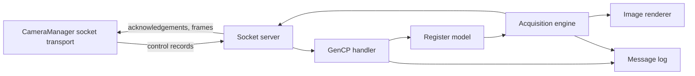

# Blackfly::CameraSimulator

## Introduction

CameraSimulator is a ground-support program, not an F Prime component. One process stands in
for one working FLIR Blackfly S BFS-U3-244S8C camera (firmware 2103.0.628.0). It serves one
client, a CameraManager socket transport, over a local socket. It answers the USB3 Vision
control messages the camera answers, with the same status and length, and sends image frames
as the camera does. Each instance has a slot number, 0 to 9. Its images carry a picture that
is different for each slot, and the slot, the image index and the time stamp in large
characters. An image is a function of a few values only, so a checker can compute it again.
The program logs every message it receives. It never imitates a faulty camera.

## Requirements

| ID | Requirement | Verification | Traces to |
|---|---|---|---|
| REQ-CamSim-001 | Control and stream messages shall comply with USB3 Vision 1.0 and GenCP 1.0. | Unit Test, Integration Test | REQ-LDC-028 |
| REQ-CamSim-002 | The simulator shall acknowledge every read and write command addressed to a Table 1 register. | Unit Test, Integration Test | REQ-LDC-028 |
| REQ-CamSim-003 | For each Table 2 trace command, acknowledgement status and length shall equal the recorded ones. | Unit Test, Integration Test | REQ-LDC-029 |
| REQ-CamSim-004 | A write meeting a Table 3 condition shall be refused with that row's status. | Unit Test | REQ-LDC-029 |
| REQ-CamSim-005 | A refused write shall leave every register value unchanged. | Unit Test | REQ-LDC-029 |
| REQ-CamSim-006 | A command meeting a Table 3 no-answer condition shall get no acknowledgement. | Unit Test | REQ-LDC-029 |
| REQ-CamSim-007 | AcquisitionStart shall get a pending acknowledgement, then success within 250 ms of the command. | Unit Test, Integration Test | REQ-LDC-029 |
| REQ-CamSim-008 | Bootstrap registers shall report the Table 4 identity, with a serial number unique per slot. | Unit Test | REQ-LDC-028 |
| REQ-CamSim-009 | Each frame shall be one leader, the payload transfers the SIRM programs, and one trailer. | Unit Test, Integration Test | REQ-LDC-028 |
| REQ-CamSim-010 | Each frame's payload length shall equal the PayloadSize register value. | Unit Test, Integration Test | REQ-LDC-028 |
| REQ-CamSim-011 | Frames shall start at the `AcquisitionResultingFrameRate` value within 2 percent over 10 s. | Unit Test | REQ-LDC-028 |
| REQ-CamSim-012 | After the AcquisitionStop acknowledgement, the simulator shall send no further leader. | Unit Test, Integration Test | REQ-LDC-028 |
| REQ-CamSim-013 | A payload longer than the programmed transfers shall be cut short with trailer status 0xA101. | Unit Test | REQ-LDC-028 |
| REQ-CamSim-014 | With nine frames waiting, each new frame shall be dropped whole and counted. | Unit Test | REQ-LDC-028 |
| REQ-CamSim-015 | Each instance shall take its slot number, 0 to 9, from a startup argument. | Unit Test | REQ-LDC-030 |
| REQ-CamSim-016 | Images of two slots, all else equal, shall differ in at least 25 percent of pixels. | Unit Test, Integration Test | REQ-LDC-030 |
| REQ-CamSim-017 | Each image of at least 800 by 256 pixels shall carry the Table 7 stamp. | Unit Test, Integration Test | REQ-LDC-031 |
| REQ-CamSim-018 | Each stamp character shall be at least 64 pixels high. | Unit Test | REQ-LDC-031 |
| REQ-CamSim-019 | The stamp's image index and time shall equal the frame leader's block ID and timestamp. | Unit Test | REQ-LDC-031 |
| REQ-CamSim-020 | Image pixels shall depend only on the Table 5 values. | Unit Test | REQ-LDC-030, REQ-LDC-031 |
| REQ-CamSim-021 | Given Table 5 values as arguments, the program shall write that image to a file. | Unit Test | REQ-LDC-030, REQ-LDC-031 |
| REQ-CamSim-022 | The simulator shall log each received message with a Table 6 verdict. | Unit Test, Integration Test | REQ-LDC-028 |
| REQ-CamSim-023 | A failed log write shall end the process with a nonzero exit status. | Unit Test | REQ-LDC-028 |
| REQ-CamSim-024 | After a client disconnect, the simulator shall serve a new client from power-up register values. | Unit Test | REQ-LDC-028 |
| REQ-CamSim-025 | A second client shall be refused while one is connected, leaving the first unaffected. | Unit Test | REQ-LDC-028 |
| REQ-CamSim-026 | A bad or incomplete socket record shall be logged as rejected and the connection closed. | Unit Test | REQ-LDC-028 |
| REQ-CamSim-027 | An invalid startup argument or unusable socket path shall end the process with nonzero status. | Unit Test | REQ-LDC-030 |
| REQ-CamSim-028 | On SIGTERM the simulator shall remove its socket and exit with status zero within 1 s. | Unit Test | REQ-LDC-028 |
| REQ-CamSim-029 | The simulator shall allocate no memory after startup. | Inspection | REQ-LDC-028 |
| REQ-CamSim-030 | A stream reset record shall end the acquisition and discard every waiting frame. | Unit Test | REQ-LDC-028 |
| REQ-CamSim-031 | With `TriggerMode` on and `TriggerSource` software, each `TriggerSoftware` shall produce one frame. | Unit Test | REQ-LDC-028 |
| REQ-CamSim-032 | With `TriggerMode` on and any other `TriggerSource`, no frame shall be produced. | Unit Test | REQ-LDC-028 |
| REQ-CamSim-033 | Each slot's image shall contain that slot's Table 8 mascot. | Unit Test | REQ-LDC-030 |
| REQ-CamSim-034 | At startup the simulator shall replace a socket file left by an ended instance. | Unit Test, Integration Test | REQ-LDC-028 |

`Integration Test` is a system test of the LDC deployment plan (`## Tests`). `Unit Test` is a
test of this module's own suite (`### Unit-test list`), run without a camera or a deployment.

### Table 1 — register model

| Region | Address | Content |
|---|---|---|
| ABRM | 0x00000 to 0x0024F | GenCP bootstrap registers |
| SBRM | 0x10000, 0x44 bytes | USB3 Vision bootstrap registers |
| SIRM | 0x20000, 0x30 bytes | stream interface registers |
| EIRM | 0x28000, 0x0C bytes | event interface registers |
| Manifest table | 0x40000 | one entry: the device description file |
| Feature registers | per feature | the 109 features of the generated register table: value, flags, minimum, maximum, increment and fraction-bit registers |

A register the capped camera does not implement (HeartbeatTimeout, DeviceSoftwareInterfaceVersion,
the IIDC2 address) is not in Table 1.

### Table 2 — recorded traces of the capped camera 01908168

| Trace (`Blackfly/pathfinder/truth/`) | Content |
|---|---|
| `02-bootstrap` | bootstrap register reads |
| `03-gencp-status`, `03b-gencp-malformed` | refused and unanswered commands |
| `04-pending-ack` | pending acknowledgement |
| `05-readback` | feature writes and read-back |
| `07-leader-trailer-chunk` | stream set-up, start, three frames, stop |
| `10a-access-while-streaming` | writes while acquiring |
| `10b-start-stop-ordering` | capture start-to-stop orderings |

### Table 3 — refusals

| Condition | Answer |
|---|---|
| value below minimum, above maximum, or off increment | 0x8002 INVALID_PARAMETER |
| enumeration value with no implemented entry | 0x8002 INVALID_PARAMETER |
| address not in Table 1, or access spanning an address not in Table 1 | 0x8003 INVALID_ADDRESS |
| write to a read-only register | 0x8004 WRITE_PROTECT |
| write to `Width`, `Height`, `PixelFormat`, `TestPattern`, `IspEnable` or `AdcBitDepth` while acquiring | 0x8006 ACCESS_DENIED |
| command received while a pending command runs | 0x8007 BUSY |
| wrong prefix, unknown command ID, or request-acknowledge flag clear | no answer |

### Table 4 — identity

| Register | Value |
|---|---|
| GenCP version, USB3 Vision version | 0x00010000, 0x00010000 |
| Manufacturer, model, family | `FLIR`, `Blackfly S BFS-U3-244S8C`, `GEN3-USB` |
| Device version | `2103.0.628.0` |
| Serial number | `9990000N`, N the slot |
| Maximum command and acknowledgement length | 1024 bytes |
| Maximum device response time | 200 ms |
| Manifest entry | the file size and SHA-1 of the device description in External References |

### Table 5 — values an image depends on

Slot; block ID; leader timestamp (ns); `PixelFormat`; `Width`, `Height`, `OffsetX`, `OffsetY`;
`ReverseX`, `ReverseY`.

### Table 6 — log verdicts

| Verdict | Meaning |
|---|---|
| `ACCEPTED` | answered as Table 1 and Table 3 say, refusals with a status included |
| `UNMODELLED` | valid command for an address not in Table 1; answered INVALID_ADDRESS |
| `REJECTED` | a Table 3 no-answer command, or a socket record with a bad header |

### Table 7 — stamp

Three lines of characters, light on a dark box, at the top left of the image:

| Line | Text | Value |
|---|---|---|
| 1 | `SLOT N` | slot |
| 2 | `IDX nnnnnnnnnn` | image index: the leader's block ID, ten digits |
| 3 | `T sssssss.mmm` | time stamp: the leader's timestamp, seconds and milliseconds, rounded down |

Characters are from the 5 by 7 dot font of `StampFont.hpp`.

### Table 8 — mascots

| Slot | Mascot | Background |
|---|---|---|
| 0 | rocket | diagonal stripes |
| 1 | rubber duck | rings |
| 2 | cat | checkerboard |
| 3 | robot | horizontal bars |
| 4 | flying saucer | dots |
| 5 | cactus | vertical bars |
| 6 | ghost | waves |
| 7 | snail | diamonds |
| 8 | teapot | zigzag |
| 9 | dinosaur | bricks |

## External References

| Document | Identifier / Revision | Type | Governs |
|---|---|---|---|
| USB3 Vision specification | AIA USB3 Vision 1.0 | Standard | bootstrap registers, control and stream framing |
| GenICam Generic Control Protocol | EMVA GenCP 1.0 | Standard | control messages, acknowledge statuses |
| BFS-U3-244S8C GenICam device description | XML model `BFS_U3_244S8`, schema 1.1, SHA-256 `9be43bbdcd76435a93e9dce4dd64e3535f0889b56e96095d0007616f98ffd4ad`; delivered as a zip of 67623 bytes, SHA-1 `ad4370397be7c60b6c00af21b3baa24054daebf1`; never committed | ICD | register addresses, types, ranges |
| Blackfly S pathfinder report and traces | lestarch-autobot/fprime-devices `blackfly-pathfinder` @ ad7ce9f, `Blackfly/pathfinder/REPORT.md`, `truth/`, `genicam/` | Other | measured behaviour of the capped camera 01908168 |
| CameraManager transport interface | lestarch-autobot/fprime-devices `campaign/CamMgr`, `Blackfly/CameraManager/docs/sdd.md` | ICD | the socket transport that connects to this program |
| LDC system design and plan | lestarch-autobot/ldc-project `devel` @ aa3b9df, `docs/ssdd.md`, `test/system/plan.md` | Other | parent requirements, system tests |
| F Prime C++ design rules | lestarch-autobot/fprime `system-campaign-skills` @ d488d24, `.github/skills/fprime-cpp-design/SKILL.md` | Standard | coding rules |

## Design

### Process

- One executable, `blackfly-camsim`. One process is one camera. C++14 in the F Prime style: no exceptions, no RTTI, fixed-width types, `FW_ASSERT`, every return value checked, bounded loops.
- It is built by the F Prime build system as an executable module of the `fprime-devices` library. It links `Fw/Types` and the C library only. It has no FPP model, no ports, commands, events, channels or parameters.
- One thread. One `poll()` loop serves the listening socket, the client socket, one timer and a signal descriptor for SIGTERM. Frame bytes are written in non-blocking pieces, so control messages are answered while a frame is on its way, as on the camera.
- All memory is taken at startup: the register store, two image buffers of the largest frame (5320 by 4600, three bytes per pixel), one control buffer of 1024 bytes, a nine-entry frame queue.
- The register table is generated at development time from the device description by the pathfinder generator and compiled in. Power-up values come from the as-found register snapshot of the capped camera. No XML is read at run time.

| Part | Does |
|---|---|
| Socket server | listens, accepts one client, splits the byte stream into records, queues output |
| GenCP handler | checks the command header, runs READMEM and WRITEMEM, builds acknowledgements and pending acknowledgements |
| Register model | holds every Table 1 register; applies access, range, increment, enumeration and lock rules; recomputes dependent limits |
| Acquisition engine | frame timer, block ID, device clock, nine-entry queue, leader, payload split, trailer |
| Image renderer | pure function from Table 5 to payload bytes |
| Message log | one text line per message and per frame |

### Startup arguments

| Argument | Meaning |
|---|---|
| `--slot N` | slot number 0 to 9; required |
| `--socket PATH` | socket path; default `/tmp/blackfly-camsim-N.sock` |
| `--log PATH` | message log file; default standard output |
| `--genicam-zip PATH` | optional local copy of the device description zip, served at its manifest address |
| `--render FILE` with `--index`, `--timestamp-ns`, `--pixel-format`, `--width`, `--height`, `--offset-x`, `--offset-y`, `--reverse-x`, `--reverse-y` | write one image to `FILE` and exit; no socket |

Exit status: 0 after SIGTERM or a completed `--render`; 1 for a bad argument; 2 for a socket error at startup; 3 for a log write error.

### Socket protocol

The socket is a Unix domain stream socket. The simulator listens; CameraManager's socket
transport connects. Connecting is plugging the camera in; closing is unplugging it.

USB3 Vision depends on transfer boundaries, and a stream socket has none. So every USB
transfer travels as one record: an 8-byte header, then the transfer bytes, unchanged.

| Offset | Size | Field |
|---|---|---|
| 0 | 2 | magic 0x4253, little-endian |
| 2 | 1 | channel: 0 control, 1 event, 2 stream |
| 3 | 1 | kind: 0 DATA, 1 RESET, 2 HELLO |
| 4 | 4 | length of the bytes that follow, little-endian; at most 1048576 |

| Record | Direction | Stands for |
|---|---|---|
| DATA, control | client to simulator | one bulk OUT transfer on the control endpoint: one GenCP command |
| DATA, control | simulator to client | one bulk IN transfer: one acknowledgement or pending acknowledgement |
| DATA, stream | simulator to client | one bulk IN transfer on the stream endpoint: a leader, one payload transfer, or a trailer |
| DATA, event | simulator to client | one event transfer; never sent |
| RESET, stream | client to simulator | clear-halt on the stream endpoint: the simulator drops queued frames and ends the acquisition |
| HELLO, control | simulator to client, once after accept | the transport's identity text: `CameraSimulator slot N serial 9990000N` |

- The record payload is byte for byte what the camera puts on the wire. GenCP framing, request IDs, pending acknowledgements and the leader, payload, trailer sequence stay above the transport, in CameraManager.
- The client reads one record for each transfer it would request from the camera. A record longer than the requested length is the client's overflow error, as with `libusb`.
- The socket's send buffer stands in for the USB host: when the client does not read, writes stop, frames wait in the queue, and the ninth waiting frame makes the next one drop.
- Any other channel, kind or direction, a wrong magic, or a length above the limit is a bad header.
- The SIRM payload transfer size register accepts at most 1048576, the value CameraManager uses on the camera, so no record exceeds the limit.
- At startup the simulator tries to connect to an existing socket path. If nothing answers, the file is left over from a killed instance and is replaced. If something answers, startup fails with status 2.

### Control behaviour

- A command is `U3VC`, flags, command ID, length, request ID, then the READMEM or WRITEMEM fields. The acknowledgement repeats the request ID. Statuses and lengths follow Table 3 and the Table 2 traces.
- Plain registers are acknowledged at once. `AcquisitionStart` sends one pending acknowledgement (0x0805, 200 ms) and the success acknowledgement 180 ms after the command. A command that arrives in between gets BUSY.
- Every feature is a block of 4-byte little-endian registers: flags, value, minimum, maximum, increment, fraction bits. A write is checked against the block's current limits. The camera never clamps, and neither does the simulator.
- Dependent limits are recomputed after each accepted write: offset maxima from width and height; `PayloadSize` from size and pixel format; `AcquisitionResultingFrameRate` from the rate model.
- Rate model: the frame period is the largest of the exposure time, the read-out time (linear in `Height`, fitted to the `06-rate` traces per pixel format) and `PayloadSize` divided by `DeviceLinkThroughputLimit`. With `AcquisitionFrameRateEnable` set, the period is not shorter than the `AcquisitionFrameRate` period.
- `TimestampLatch` copies the device clock, nanoseconds since process start, into the latch value register.
- Reads of the device description file answer from the `--genicam-zip` file when given; otherwise they are `UNMODELLED`.
- With `TriggerMode` off, frames follow the rate model. With `TriggerMode` on and `TriggerSource` `Software`, each `TriggerSoftware` write queues one frame. With any other source no frame comes: the simulator has no trigger line.
- On client disconnect every register returns to its power-up value.

### Stream behaviour

- A frame is a 52-byte leader (`U3VL`, block ID, payload type 0x0001, timestamp, pixel format, size, offset), the payload, and a 32-byte trailer (`U3VT`, block ID, status, valid payload size, line count).
- The payload is split as the SIRM says: `count` transfers of the programmed size, then final transfer 1, then final transfer 2. No zero-length transfer is sent.
- The first leader leaves 180 ms plus the exposure time after `AcquisitionStart`. Later frames start one frame period apart, on the monotonic clock.
- The block ID counts frames. It continues over stop and start while the stream stays enabled. It restarts at 0 when the stream is enabled again.
- The queue holds block ID and timestamp only. The image is rendered when its turn to be sent comes, so nine waiting frames cost no image memory.
- A dropped frame leaves a gap in the block IDs and adds one to `TransferQueueOverflowCount`.
- `AcquisitionStop` empties the queue. A frame already begun is finished.

### Image

- Each slot has a mascot, a background (Table 8) and two colours. The mascot is a 16 by 16 pixel drawing, enlarged to a quarter of the image height. It moves along a path that depends on the block ID.

- The background of slot N has a period of 96 + 16·N pixels and its own shape, so two slots differ over most of the image.
- The stamp is Table 7. Its time is the simulator's device clock, the one the leader carries, not the system time CameraManager records at arrival. The `START` log line gives the wall-clock time of device time zero.
- Glyphs are 5 by 7 dots in a 6 by 8 cell. A dot is a square of `k` pixels, `k` = 10 or more, growing with the image width up to 32. A character is 7·k pixels high: 70 at least. The stamp needs 780 by 240 pixels at `k` = 10.
- The stamp is drawn light on a dark box. In Bayer formats every pixel of a dot has the same value, so the characters survive without colour processing.
- The image is drawn in sensor coordinates. `OffsetX` and `OffsetY` move the window over the mascot and background; the stamp stays at the window's top left. `ReverseX` and `ReverseY` mirror the background and mascot, not the stamp.
- Pixel formats rendered: `BayerRG8`, `BayerRG16`, `BayerRG10p`, `BayerRG12p`, `Mono8`, `RGB8Packed`. Exposure, gain and the other analog features change no pixel.
- Reading the stamp back: a checker finds the box, measures `k`, and matches each cell against the 5 by 7 font.
- Computing an image again: read slot, index and time from the stamp, take format and geometry from the product record, run `--render`, and compare the files.
- Cost: the background is drawn into the first buffer when format or geometry changes. Each frame copies it to the second buffer and draws mascot and stamp there. A full frame is one 24 MB copy.

### Message log

One line of text per event, fields separated by spaces, time first (microseconds since start):

| Line | Fields |
|---|---|
| `MSG` | channel, kind, length, command ID, request ID, address, count, verdict, acknowledgement status and length |
| `FRAME` | block ID, timestamp, payload size, trailer status; or `DROPPED` |
| `CLIENT` | `CONNECTED`, `DISCONNECTED`, `REFUSED` |
| `START`, `EXIT` | arguments; totals of each verdict, frames sent and frames dropped |

Each line is written and flushed before the answer is sent.

### Commands, events, telemetry, parameters, ports

None. The program is not an F Prime component. Its interfaces are the startup arguments, the
socket and the log.

### Out-of-scope failure modes

| Failure mode | Reason |
|---|---|
| Camera that does not start or stream | simulator imitates the working camera only |
| Rounded read-back of accepted values | not needed by any allocated requirement |
| Camera events and chunk data | fixed off by the system |
| Pixel formats other than the six rendered | refused with INVALID_PARAMETER; not measured |
| Images smaller than 800 by 256 | stamp is cut at the image edge |
| Hardware trigger lines | simulator has no lines; a line source gives no frames |
| Two instances given the same slot | second fails at the socket path; bench recipe gives unique slots |
| Client that never reads | frames drop; no timeout, as on the camera |

### Unit-test list

Tests run under `ctest` in this module. Tests named `Process*` start the built program and
talk to it over its socket.

| Test | Description | Requirements |
|---|---|---|
| GenCpFraming | Command and acknowledgement headers match USB3 Vision 1.0 and GenCP 1.0 layouts. | REQ-CamSim-001 |
| RegisterReadAll | Every Table 1 register is read with success and its declared length. | REQ-CamSim-002 |
| RegisterWriteAll | Every writable Table 1 register accepts its minimum and maximum. | REQ-CamSim-002 |
| TraceReplay | Each Table 2 trace command gets the recorded status and length. | REQ-CamSim-003 |
| RefusalTable | Each Table 3 status condition gives its status. | REQ-CamSim-004 |
| RefusalLeavesState | After each refused write, all register values equal those before it. | REQ-CamSim-005 |
| NoAnswerTable | Each Table 3 no-answer condition gives no acknowledgement and the next command works. | REQ-CamSim-006 |
| PendingAck | AcquisitionStart gives a pending acknowledgement, success within 250 ms, and BUSY in between. | REQ-CamSim-004, REQ-CamSim-007 |
| Identity | Bootstrap registers hold Table 4 values and ten slots give ten serial numbers. | REQ-CamSim-008 |
| FrameSequence | A frame is leader, programmed payload transfers and trailer, for four stream set-ups. | REQ-CamSim-009 |
| PayloadSize | Payload length equals PayloadSize for each rendered format and three sizes. | REQ-CamSim-010 |
| ProcessFrameRate | Frame starts over 10 s match the resulting frame rate within 2 percent, at three rates. | REQ-CamSim-011 |
| StopEndsFrames | No leader follows the AcquisitionStop acknowledgement. | REQ-CamSim-012 |
| PayloadTruncated | A payload longer than the programmed transfers is cut and its trailer reads 0xA101. | REQ-CamSim-013 |
| ProcessSlowClient | A client that stops reading loses whole frames; block ID gaps equal the overflow count. | REQ-CamSim-014 |
| SlotArgument | Slots 0 to 9 are accepted and shown; 10, -1 and text are refused. | REQ-CamSim-015, REQ-CamSim-027 |
| SlotsDiffer | All 45 slot pairs differ in at least 25 percent of pixels, per format. | REQ-CamSim-016 |
| StampReadBack | Characters read from images equal slot, block ID and timestamp, per format. | REQ-CamSim-017, REQ-CamSim-019 |
| StampHeight | Measured character height is at least 64 pixels at the smallest and largest sizes. | REQ-CamSim-018 |
| RenderPure | Equal Table 5 values give equal bytes; analog register changes alter no pixel. | REQ-CamSim-020 |
| ProcessRenderFile | The render arguments write a file equal to the streamed frame's payload. | REQ-CamSim-019, REQ-CamSim-021 |
| LogVerdicts | Accepted, unmodelled and rejected messages each give one log line with that verdict. | REQ-CamSim-022 |
| ProcessLogFailure | A log file that cannot be written ends the process with status 3. | REQ-CamSim-023 |
| ProcessReconnect | After a disconnect while acquiring, a new client finds power-up registers and no frames. | REQ-CamSim-024 |
| ProcessSecondClient | A second client is refused and the first still gets acknowledgements and frames. | REQ-CamSim-025 |
| BadRecord | Each bad header kind and a record cut short is logged rejected and closes the connection. | REQ-CamSim-026 |
| StreamReset | A stream reset record ends the acquisition and no queued frame arrives. | REQ-CamSim-030 |
| SoftwareTrigger | Five TriggerSoftware writes give five frames; none without a write. | REQ-CamSim-031 |
| LineTrigger | With a line trigger source, no frame arrives in 2 s and control still answers. | REQ-CamSim-032 |
| MascotPresent | Each slot's image contains its mascot drawing at the computed place and scale. | REQ-CamSim-033 |
| ProcessBadSocketPath | An unusable socket path ends the process with status 2. | REQ-CamSim-027 |
| ProcessStaleSocket | After SIGKILL, a new instance on the same path starts and serves a client. | REQ-CamSim-034 |
| ProcessSigterm | SIGTERM removes the socket and ends the process with status 0 within 1 s. | REQ-CamSim-028 |

The stamp tests read characters with a reader in the test code that holds its own copy of the
font, and `SlotsDiffer` also checks ten stored image checksums, so a renderer fault is not
hidden by a matching fault in the checker.

Coverage target: 95 percent of lines. REQ-CamSim-029 is inspected: no allocation call is
reachable after startup.

## Tests

System tests of the LDC plan that exercise the simulator. They are run by the project campaign.

| Test | Description | Requirements |
|---|---|---|
| L2-4 | Simulator and capped camera acknowledgements match from capture start to stop; no message rejected. | REQ-CamSim-001, REQ-CamSim-002, REQ-CamSim-003, REQ-CamSim-007, REQ-CamSim-009, REQ-CamSim-010, REQ-CamSim-012, REQ-CamSim-022 |
| L2-5 | Each simulator's stored image differs from the others and shows slot, index and time. | REQ-CamSim-016, REQ-CamSim-017 |
| L5-1 | A killed simulator faults only its slot; restarted, it captures again. | REQ-CamSim-034 |
