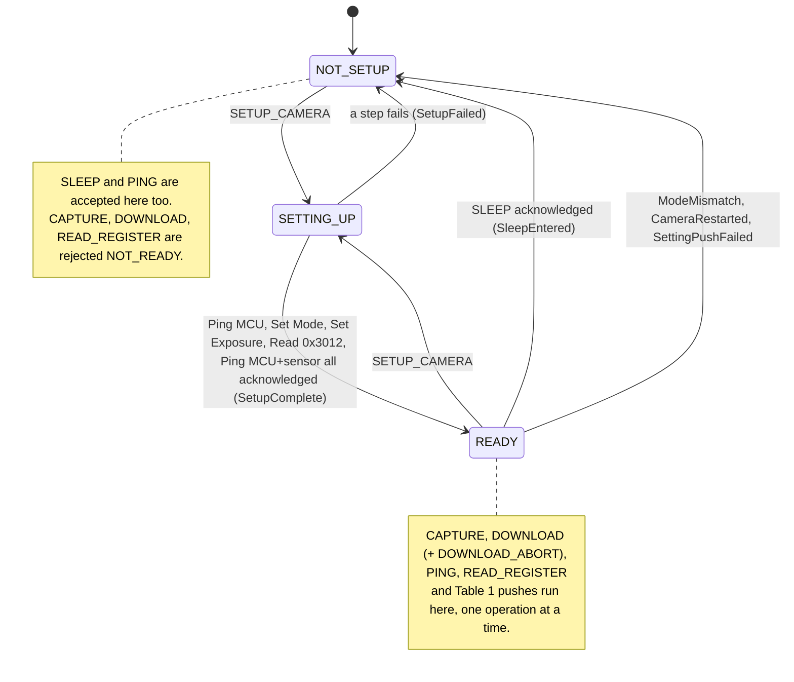
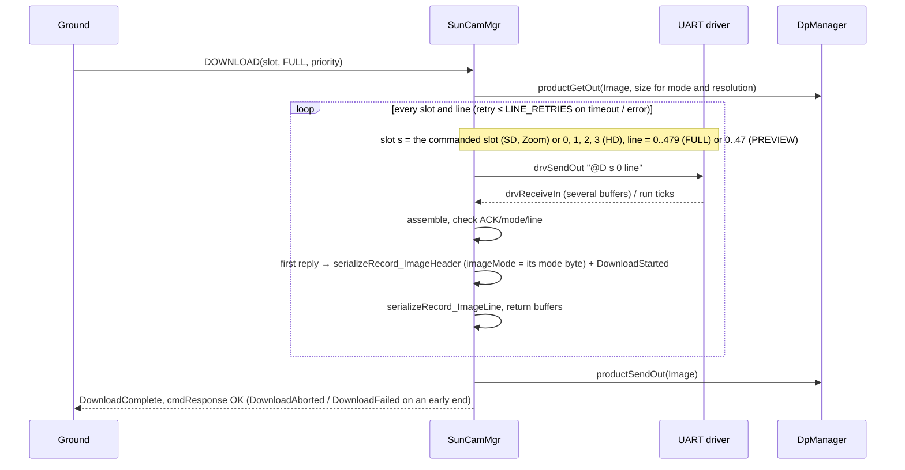

# KissCam::SunCamMgr (Active Component)

## 1. Introduction

`KissCam::SunCamMgr` is an active F Prime component that manages an MVP Aerospace KissCAM V2 sun camera over a UART
byte-stream driver (115200 baud, 8N1, set by the deployment). It turns ground commands into the camera's seven-byte
command frames, parses the camera's reply frames, reflects the camera's reported mode, exposure and counters in telemetry
and events, applies the persisted camera settings (Table 1) at set-up, and delivers each image
readout as one F Prime data product (SD and Zoom: the one slot downloaded; HD: the four quadrant slots 0..3 as one 1280 × 960 / 128 × 96 image). A camera operation is one `SETUP_CAMERA`, one Table 1 push with its follow-ups, one whole `DOWNLOAD`, or
one other command/reply exchange; at most one operation is in progress at a time. The camera is powered by another component, so the operator calls
`SETUP_CAMERA` once it is on; until then the component is NOT_SETUP.

Reference document: KissCAM V2 Datasheet and User Manual, Revision 1.3 (May 2025), as qualified by §7.1. The camera
reports no firmware revision in-band; at power-on it emits one unframed ASCII line "MVP Camera V2 RS422\r\n" (21 bytes), which while
READY is the camera-restart signal (REQ-034). The datasheet's Write Register command is not used. Memory Status is not
implemented by the camera (§7.4.3) and is not commanded.

## 2. Requirements

| ID | Requirement | Verification |
|---|---|---|
| REQ-SunCamMgr-001 | Frames sent and parsed shall comply with Datasheet Rev. 1.3 §7 as qualified by §7.1. | Unit Test |
| REQ-SunCamMgr-002 | Camera frames shall be sent only for a Table 2 command or Table 1 push. | Unit Test |
| REQ-SunCamMgr-003 | `SETUP_CAMERA` shall run the Table 2 set-up exchanges in order, then become READY. | Unit Test |
| REQ-SunCamMgr-004 | A failed set-up step shall return the component to NOT_SETUP with a WARNING_HI event. | Unit Test |
| REQ-SunCamMgr-005 | `SETUP_CAMERA` shall be accepted in NOT_SETUP and READY. | Unit Test |
| REQ-SunCamMgr-006 | `SLEEP` and `PING` shall be accepted in NOT_SETUP and READY. | Unit Test |
| REQ-SunCamMgr-007 | `SLEEP` shall command camera mode Sleep and return the component to NOT_SETUP. | Unit Test |
| REQ-SunCamMgr-008 | Table 2 commands marked READY shall be rejected with a WARNING_LO event when not READY. | Unit Test |
| REQ-SunCamMgr-009 | A command except `DOWNLOAD_ABORT` during an operation shall be rejected BUSY with a WARNING_LO event. | Unit Test |
| REQ-SunCamMgr-010 | Table 1 parameters changed while READY shall be pushed when no operation is in progress. | Unit Test |
| REQ-SunCamMgr-011 | A failed parameter push shall return the component to NOT_SETUP with a WARNING_HI event. | Unit Test |
| REQ-SunCamMgr-012 | Exposure shall be read back from register 0x3012 after every exposure push and reported. | Unit Test |
| REQ-SunCamMgr-013 | `CAPTURE` shall send Capture with the commanded slot and test-pattern flag and accept the 0-byte ACK. | Unit Test |
| REQ-SunCamMgr-014 | `DOWNLOAD` shall request every line of each Table 2 image slot in order. | Unit Test |
| REQ-SunCamMgr-015 | A download shall produce one data product per image: Table 4 header, then slot-tagged line records. | Unit Test |
| REQ-SunCamMgr-016 | A failed or timed-out line reply shall be retried LINE_RETRIES times before the download fails. | Unit Test |
| REQ-SunCamMgr-017 | A download ended early shall deliver lines received: ACTIVITY_HI event if commanded, WARNING_HI otherwise. | Unit Test |
| REQ-SunCamMgr-018 | No reply within REPLY_TIMEOUT_TICKS `run` ticks shall fail the exchange with a WARNING_HI event. | Unit Test |
| REQ-SunCamMgr-019 | A camera error reply shall raise a WARNING_HI event carrying command, error type and count. | Unit Test |
| REQ-SunCamMgr-020 | Bytes outside a frame and out-of-operation, malformed or wrong-command frames shall be discarded and counted with a WARNING_LO event. | Unit Test |
| REQ-SunCamMgr-021 | While READY, a reply whose mode ≠ commanded mode shall cause NOT_SETUP with a WARNING_HI event. | Unit Test |
| REQ-SunCamMgr-022 | The component shall report the Table 3 telemetry from the source named for each channel. | Unit Test |
| REQ-SunCamMgr-023 | Every command outcome and every Table 1 setting applied shall be reported by an event. | Unit Test |
| REQ-SunCamMgr-024 | A UART send or data-product allocation failure shall end the operation with a WARNING_HI event. | Unit Test |
| REQ-SunCamMgr-025 | Table 2 commands shall run their exchange and report the reply by event and telemetry. | Unit Test |
| REQ-SunCamMgr-026 | `DOWNLOAD_ABORT` with no download in progress shall be rejected with a WARNING_LO event. | Unit Test |
| REQ-SunCamMgr-027 | A CAMERA_MODE push shall be followed by an EXPOSURE push and its readback. | Unit Test |
| REQ-SunCamMgr-028 | An exposure readback differing from the pushed value shall cause NOT_SETUP with a WARNING_HI event. | Unit Test |
| REQ-SunCamMgr-029 | A full queue shall drop the newest input: buffer returned, command answered BUSY, WARNING_HI event. | Unit Test |
| REQ-SunCamMgr-030 | Component state and counter channels shall be written on change and every TLM_PERIOD_TICKS `run` ticks. | Unit Test |
| REQ-SunCamMgr-031 | An out-of-range EXPOSURE shall send no frame; a push is refused, WARNING_LO event, READY kept. | Unit Test |
| REQ-SunCamMgr-033 | A Capture outcome shall report the `Exposure` channel value as the exposure used. | Unit Test |
| REQ-SunCamMgr-034 | The camera's power-on line (Table 4) received while READY shall cause NOT_SETUP with a WARNING_HI event. | Unit Test |
| REQ-SunCamMgr-035 | In HD, `CAPTURE` and `DOWNLOAD` shall be rejected with a WARNING_LO event unless slot is SLOT_0. | Unit Test |
| REQ-SunCamMgr-036 | Capture shall be sent only while READY. | Unit Test |
| REQ-SunCamMgr-037 | `DOWNLOAD` shall set the `Image` product priority to its `priority` argument, or `IMAGE_DP_PRIORITY` when zero. | Unit Test |

## 3. Design

### 3.1. Component Diagram

```
 drvConnected : Drv.ByteStreamReady ─▶┌─────────────────────────────┐─▶ drvSendOut : Drv.ByteStreamSend
 drvReceiveIn : Drv.ByteStreamData  ─▶│     KissCam.SunCamMgr       │─▶ drvReceiveReturnOut : Fw.BufferSend
 run : Svc.Sched                    ─▶│          (active)           │─▶ pingOut : Svc.Ping
 pingIn : Svc.Ping                  ─▶└─────────────────────────────┘─▶ productGetOut, productSendOut (data products)
```

### 3.2. Ports

| Port | Kind | Type | Purpose |
|---|---|---|---|
| drvConnected | async input, `drop` | Drv.ByteStreamReady | driver ready; handler empty, no state kept |
| drvReceiveIn | async input, `hook` | Drv.ByteStreamData | camera bytes, framed on the component thread |
| drvReceiveReturnOut | output | Fw.BufferSend | return driver receive buffers |
| drvSendOut | output | Drv.ByteStreamSend | send a 7-byte frame from the component's buffer |
| run | sync input | Svc.Sched | rate-group tick; queues at most one `runInternal` |
| runInternal | internal port, `hook` | — | the tick on the component thread: reply timeout, deferred parameter push, periodic channels |
| pingIn / pingOut | async input `hook` / output | Svc.Ping | health ping |
| productGetOut / productSendOut | product get / send | — | allocate and deliver the Image container |

Hooks are used to report BUSY to the command dispatcher on queue overflow.

### 3.3. State

| State | Values | Meaning |
|---|---|---|
| `SetupState` (channel) | NOT_SETUP, SETTING_UP, READY | whether the camera has been set up by this component; only READY admits camera-touching Table 2 commands |
| `CurrentOperation` (channel) | NONE or one Table 2 command / PARAMETER_PUSH | the single operation in progress; a Table 2 command is admitted only when NONE |
| commanded mode | SLEEP, SD, ZOOM, HD | mode the camera was last told to be in; every reply's mode byte is checked against it while READY (SLEEP exempt) |
| pending exchange | command byte, echoed parameters, ticks waiting | the one frame awaiting a reply; REPLY_TIMEOUT_TICKS bounds the wait |
| dirty flags | CAMERA_MODE, EXPOSURE | Table 1 values changed since last pushed (set by `parameterUpdated`, cleared by the push) |
| download bookkeeping | slot, resolution, lines per slot, lines received, attempt, abort requested, `DpContainer` | the `DOWNLOAD` in progress, see §4 |
| counters | Table 3 component counters | written on change and every TLM_PERIOD_TICKS ticks |



### 3.4. Configuration and Setup

`KissCamConfig` is a `register_fprime_config` module; a deployment overrides `KissCamConfig.fpp` through its config
directory. The deployment drives `run` at 10 Hz (REPLY_TIMEOUT_TICKS × period = 2 s, datasheet §7) and opens the UART at
115200 8N1; the operator sends `SETUP_CAMERA` once the camera is powered.

```fpp
constant REPLY_TIMEOUT_TICKS = 20   # run ticks per reply (2 s at 10 Hz)
constant LINE_RETRIES = 3           # re-requests of one line before the download aborts
constant IMAGE_DP_PRIORITY = 10     # default priority of the Image container
constant TLM_PERIOD_TICKS = 10      # run ticks between periodic channel re-writes (1 s at 10 Hz)
constant EXPOSURE_MIN = 2            # EXPOSURE range the component sends (datasheet §7.4.4)
constant EXPOSURE_MAX = 960
instance sunCamMgr: KissCam.SunCamMgr base id 0x... queue size 64 stack size 65536 priority 100
```

Table 4 — Constants and data-product records

| Name | Value | Meaning |
|---|---|---|
| REPLY_TIMEOUT_TICKS | 20 (configurable) | `run` ticks allowed per camera reply (datasheet: 2000 ms) |
| LINE_RETRIES | 3 (configurable) | re-requests of one image line before the download fails |
| IMAGE_DP_PRIORITY | 10 (configurable) | `Image` product priority when `DOWNLOAD` is commanded with priority 0 (REQ-037) |
| TLM_PERIOD_TICKS | 10 (configurable) | `run` ticks between periodic writes of the component state and counter channels (1 s at 10 Hz) |
| EXPOSURE_MIN, EXPOSURE_MAX | 2, 960 | EXPOSURE values the component sends (datasheet §7.4.4) |
| FULL_LINES, PREVIEW_LINES | 480, 48 | Download line requests per slot (`KissCam` constant; §7.1); an HD image is 4 slots: 1920 / 192 |
| FULL_PIXELS, PREVIEW_PIXELS | 640, 64 | pixel bytes per line reply (`KissCam` constant; §7.1) |
| POWER_ON_LINE | "MVP Camera V2 RS422\r\n" (21 bytes) | unframed line the camera emits at power-on (§7.1); while READY its receipt means the camera restarted (REQ-034) |
| ImageHeader record | struct, §4 | first record of every image product, written when the first line reply arrives |
| ImageLine record | U8 array, §4 | one record per line received |

### 3.5. Port Handlers

#### 3.5.1. Commands

A Table 2 command is admitted only when no operation is in progress (else BUSY) and, for the READY-only commands, only while
READY (else NOT_READY); every refusal is one `CommandRejected`. The accepted command sends its 7-byte frame on `drvSendOut` and
its response is returned when the operation ends; `DOWNLOAD_ABORT` stops a running download after the pending line.

#### 3.5.2. parameterUpdated

Sets the dirty flag of the changed Table 1 parameter; `SETUP_CAMERA` applies both, and the tick pushes dirty ones while READY and
idle. A CAMERA_MODE push is followed by an EXPOSURE push and readback because a mode change resets the sensor registers
(REQ-027); EXPOSURE is range-checked locally before any frame is sent.

#### 3.5.3. drvReceiveIn

Assembles reply frames (0x40, length, payload, 0x0D) in a component-local buffer, returns the driver buffer, and matches the
frame to the outstanding command byte and its echoed parameters. A matching reply is decoded into events and channels and
advances the operation (next set-up step, next line, or command response); everything else is counted and discarded or ends the operation (§5.4).

#### 3.5.4. run and runInternal

`run` (rate-group thread) sets the atomic `m_runQueued` and queues at most one `runInternal` message. `runInternal` reports
queue drops, counts the reply timeout, pushes dirty parameters and re-writes the state and counter channels every
TLM_PERIOD_TICKS ticks.

## 4. Data Product Format

One `Image` container per downloaded image, allocated at the `DOWNLOAD` command and sent when the download completes, aborts
or fails (the records received so far are delivered). The product priority is set at allocation: the `DOWNLOAD` `priority`
argument (1..2^32−1; lower is sent first by `Svc.DpCatalog`), or `KissCamConfig.IMAGE_DP_PRIORITY` when it is 0 — priority 0 is
not commandable through `DOWNLOAD`.

| Container | Record id | Record | Type | Count |
|---|---|---|---|---|
| `Image` | 0 | `ImageHeader` | `KissCam.ImageHeader` struct | 1, written on the first line reply |
| `Image` | 1 | `ImageLine` | `U8 array` | one per line received: 480 / 48 per slot (FULL / PREVIEW); HD 1920 / 192 |

`ImageHeader` fields

| Field | Type | Value |
|---|---|---|
| slot | `Slot` | commanded slot (SLOT_0 for an HD image) |
| imageMode | `Mode` | mode byte of the first line reply |
| resolution | `Resolution` | FULL or PREVIEW |
| width, height | `U16` | 640 × 480 / 64 × 48; HD 1280 × 960 / 128 × 96 |
| exposure | `U16` | the last pushed or read-back exposure (the camera reports none) |
| linesExpected | `U16` | 480 / 48; HD 1920 / 192 |

`ImageLine` layout

| Bytes | Content |
|---|---|
| 0 | slot; in HD the quadrant: 0 top-left, 1 top-right, 2 bottom-left, 3 bottom-right |
| 1–2 | line number, MSB first |
| 3… | 640 (FULL) or 64 (PREVIEW) pixel bytes in camera order |

## 5. Ground Interface

### 5.1. Commands

Table 2 — Commands (ground operations)

| Command | Arguments | Needs READY | Camera exchange(s) |
|---|---|---|---|
| SETUP_CAMERA | — | no | set-up steps, in order: Ping MCU, Set Mode, Set Exposure (preceded by the local EXPOSURE range check), Read Register 0x3012, Ping MCU+sensor |
| SLEEP | — | no | Set Mode Sleep |
| PING | type: MCU, MCU_AND_SENSOR | no | Ping |
| CAPTURE | slot: SLOT_0..SLOT_3 (SLOT_0 only in HD, REQ-035), testPattern: OFF/ON | yes | Capture |
| DOWNLOAD | slot: SLOT_0..SLOT_3 (SLOT_0 only in HD, REQ-035), resolution: FULL/PREVIEW, priority: FwDpPriorityType 1..2^32−1 (0 = KissCamConfig.IMAGE_DP_PRIORITY) | yes | Download × FULL_LINES / PREVIEW_LINES of the commanded slot; in HD of slots 0, 1, 2, 3 in order |
| DOWNLOAD_ABORT | — | no (accepted only during a download) | none; the download stops after the pending line |
| READ_REGISTER | address U16 | yes | Read Register |

### 5.2. Parameters

Table 1 — Parameters (persisted camera settings, pushed at set-up and on change)

| Parameter | Type / range | Default | Camera command |
|---|---|---|---|
| CAMERA_MODE | enum SD = 1, ZOOM = 2, HD = 3 (the Set Mode byte, §7.4.2) | SD | Set Mode (`M`) |
| EXPOSURE | U16, EXPOSURE_MIN..EXPOSURE_MAX (2..960) steps of 89.5 µs, checked by the component (§7.4.4) | 672 | Set Exposure (`E`) |

### 5.3. Telemetry

Table 3 — Telemetry

| Channel | Type | Source |
|---|---|---|
| SetupState | enum NOT_SETUP, SETTING_UP, READY | component state |
| CurrentOperation | enum NONE, SETUP_CAMERA, SLEEP, PING, CAPTURE, DOWNLOAD, READ_REGISTER, PARAMETER_PUSH | component state (NONE when no operation is in progress) |
| CameraMode | enum SLEEP = 0, SD = 1, ZOOM = 2, HD = 3 (the reply mode byte, §7.2) | mode byte of every reply |
| Exposure | U16 | EXPOSURE value whose Set Exposure was acknowledged (the Capture ACK carries none) |
| ExposureReadback | U16 | Read Register 0x3012 reply |
| CameraUptime | U16 s | Ping reply |
| RegisterValue | {address, value} | READ_REGISTER command reply |
| CameraValidCmds, CameraInvalidCmds | U8 | Ping / error replies |
| LastCameraError | {command, errorType, count} | error reply |
| Exchanges, CameraErrors, Timeouts, DiscardedBytes, MalformedReplies | U32 | component counters |
| ImagesCaptured, LinesDownloaded, ProductsSent, QueueOverflows | U32 | component counters |

### 5.4. Events

| Event (args) | Severity | When |
|---|---|---|
| SetupStarted | ACTIVITY_LO | SETUP_CAMERA accepted |
| SetupComplete(mode, exposure) | ACTIVITY_HI | last set-up exchange acknowledged; READY |
| SetupFailed(step, cause) | WARNING_HI | a set-up exchange failed; NOT_SETUP |
| SettingApplied(setting, value) | ACTIVITY_HI | Set Mode / Set Exposure acknowledged |
| SettingRejected(setting, value, min, max) | WARNING_LO | EXPOSURE outside EXPOSURE_MIN..MAX refused before any frame; the applied value stands |
| SettingPushFailed(setting, cause) | WARNING_HI | push outside set-up failed; NOT_SETUP |
| ExposureReadback(pushed, readback) | ACTIVITY_LO | register 0x3012 read after an exposure push |
| SleepEntered | ACTIVITY_HI | Set Mode Sleep acknowledged; NOT_SETUP |
| PingReply(pingType, validCmds, invalidCmds, uptime) | ACTIVITY_LO | Ping acknowledged |
| CaptureComplete(slot, testPattern, exposure, mode) | ACTIVITY_HI | Capture acknowledged (slot as sent; exposure = the `Exposure` channel value, the last pushed/read-back exposure) |
| DownloadStarted(slot, imageMode, resolution, lines) | ACTIVITY_LO | first line reply received: imageMode = its mode byte, ImageHeader record written (the product was allocated at the command) |
| DownloadComplete(slot, imageMode, resolution, lines, bytes) | ACTIVITY_HI | last line stored, product sent; bytes = image bytes received (lines × 640 or × 64), not serialized record bytes |
| DownloadAborted(slot, linesReceived) | ACTIVITY_HI | DOWNLOAD_ABORT ended the download; lines received delivered |
| DownloadFailed(slot, linesReceived, cause) | WARNING_HI | download ended on a fault (LINE_FAILED, SEND_FAILED, PRODUCT_FULL, CAMERA_RESTART); lines received delivered; a ModeMismatch during the line phase is reported as LINE_FAILED preceded by the ModeMismatch event |
| LineRetry(line, attempt) | DIAGNOSTIC | a line is re-requested |
| RegisterRead(address, value) | ACTIVITY_HI | Read Register acknowledged |
| CommandRejected(operation, cause) | WARNING_LO | NOT_READY, BUSY, NO_DOWNLOAD, HD_SLOT; response EXECUTION_ERROR (BUSY for cause BUSY) |
| CameraError(operation, cmdByte, errorType, count) | WARNING_HI | 0xFF reply |
| ReplyTimeout(operation, cmdByte) | WARNING_HI | REPLY_TIMEOUT_TICKS elapsed |
| FrameDiscarded(cause, bytes, head), throttle 10 | WARNING_LO | NO_OPERATION, MALFORMED, WRONG_COMMAND; first 8 bytes kept |
| ModeMismatch(commanded, reported) | WARNING_HI | reply mode ≠ commanded while READY; NOT_SETUP |
| CameraRestarted(operation) | WARNING_HI | the POWER_ON_LINE arrived while READY or SETTING_UP (operation = the one in progress, NONE when idle); NOT_SETUP |
| SendFailed(operation, status) | WARNING_HI | driver refused the frame |
| ProductAllocationFailed(bytes) | WARNING_HI | no Image container of the needed size |
| QueueOverflow(source, dropped), throttle 10 | WARNING_HI | drops counted by the hooks since the last tick (COMMAND, UART_RECEIVE, RUN_TICK, HEALTH_PING) |

## 6. Example Uses

### 6.1. Sequence Diagrams

The `DOWNLOAD` operation, from the command to the delivered `Image` product:



## 7. Idiosyncrasies

### 7.1. Camera

Where the camera unit differs from Datasheet Rev 1.3; the component follows the unit.

| Item | Documented (Rev 1.3) | Observed | Design |
|---|---|---|---|
| Preview image | 80 × 60, 60 lines (§7.4.6) | 64 × 48: line = 2-byte echo + 64 pixels (LEN 0x0042), 48 lines; a line ≥ 48 returns the next region | PREVIEW = 64 × 48 throughout |
| Memory slot index | Capture 0–3, Download 1–4 (§7.4.5, §7.4.6) | 0–3 in both frames; index 4 writes a fifth view that aliases slot 1 | `Slot` = SLOT_0..SLOT_3 |
| Capture in Sleep | needs SD, Zoom or HD (§7.4.2) | a live Capture in Sleep can hang the camera until a power cycle | Capture is sent only while READY (REQ-036) |
| Parameter validation | error types 2 and 3 (§7.4.9) | out-of-range slot, line, exposure and address are answered with normal frames; a read past an image runs into the next slot | every range check is the component's (REQ-031) |
| Power-on line | undocumented | 21 unframed bytes "MVP Camera V2 RS422\r\n" at power-on, camera then in Sleep | READY: `CameraRestarted`, NOT_SETUP (REQ-034); NOT_SETUP: discarded (REQ-020) |
| Memory Status `S` | listed (§7.3), "not implemented" (§7.4.3) | answers error type 1 | not commanded; the operator tracks captures |

### 7.2. Out of scope

| Failure | Owner |
|---|---|
| Camera power off / power cycling | the power-control component; operator re-runs SETUP_CAMERA |
| Camera health while idle | operator PING (REQ-002: no autonomous frames); a power-cycle is detected by the power-on line (REQ-034) |
| Serial device missing, wrong baud, driver read errors | Drv.PosixUartDriver and the deployment |
| Data-product storage, cataloguing and downlink | Svc.DpManager / DpWriter / DpCatalog |

## 8. Tests

System tests run on the `SunCamRef` deployment (fprime-devices-reference) on the Raspberry Pi 5 bench against the KissCAM V2
bench unit; the plan (`SunCamRef/test/int/plan.json`) is the source of this table. The camera-side fault paths the bench
cannot force (timeouts, failed set-up, send/allocation failure, queue full, stray bytes, camera error replies, mode mismatch, camera restart) are unit tests.
L8-1 needs the human to power-cycle the camera: it runs in the run-for-record only and is deferred in rehearsal and dry runs.

### 8.1. System Tests

<!-- fth:tests:begin -->
_Generated by `fth render-sdd-tests` from the plan — do not edit by hand; the package renderer fails when this table and the plan disagree._

| Test | Purpose | Requirements |
|---|---|---|
| L0-1 | Image identity and boot state | REQ-SunCamMgr-002, REQ-SunCamMgr-030 |
| L0-2 | Marker round-trip | REQ-SunCamMgr-030 |
| L2-1 | Set-up from NOT_SETUP and re-entrant from READY | REQ-SunCamMgr-001, REQ-SunCamMgr-003, REQ-SunCamMgr-005, REQ-SunCamMgr-012, REQ-SunCamMgr-022, REQ-SunCamMgr-023 |
| L2-2 | Ping MCU and MCU+sensor | REQ-SunCamMgr-006, REQ-SunCamMgr-022, REQ-SunCamMgr-025 |
| L2-3 | Capture test pattern and live frame | REQ-SunCamMgr-001, REQ-SunCamMgr-013, REQ-SunCamMgr-022, REQ-SunCamMgr-025, REQ-SunCamMgr-033 |
| L2-4 | Preview download → Image data product (decoded) | REQ-SunCamMgr-001, REQ-SunCamMgr-014, REQ-SunCamMgr-015, REQ-SunCamMgr-037 |
| L2-5 | Full download → Image data product (decoded) | REQ-SunCamMgr-014 |
| L2-6 | EXPOSURE parameter push and readback | REQ-SunCamMgr-010, REQ-SunCamMgr-012, REQ-SunCamMgr-023 |
| L2-7 | Sleep from READY and from NOT_SETUP; READY-only command rejected | REQ-SunCamMgr-006, REQ-SunCamMgr-007, REQ-SunCamMgr-008 |
| L2-8 | Register read of the exposure register | REQ-SunCamMgr-012, REQ-SunCamMgr-025 |
| L2-9 | CAMERA_MODE push re-pushes exposure | REQ-SunCamMgr-010, REQ-SunCamMgr-012, REQ-SunCamMgr-023, REQ-SunCamMgr-027 |
| L2-10 | HD capture and preview download → four-quadrant 128×96 product tagged HD | REQ-SunCamMgr-013, REQ-SunCamMgr-014, REQ-SunCamMgr-015, REQ-SunCamMgr-033 |
| L2-11 | Preview download with commanded priority → Image product priority 7 | REQ-SunCamMgr-037 |
| L3-1 | EXPOSURE persists across a restart | REQ-SunCamMgr-003, REQ-SunCamMgr-005, REQ-SunCamMgr-010, REQ-SunCamMgr-027 |
| L5-1 | Busy rejection and commanded download abort | REQ-SunCamMgr-009, REQ-SunCamMgr-017 |
| L5-3 | Out-of-range exposure refused locally; set-up fails before Set Exposure | REQ-SunCamMgr-002, REQ-SunCamMgr-004, REQ-SunCamMgr-031 |
| L6-1 | Negative control: READY-only commands refused while NOT_SETUP | REQ-SunCamMgr-002, REQ-SunCamMgr-007, REQ-SunCamMgr-008, REQ-SunCamMgr-026, REQ-SunCamMgr-036 |
| L6-2 | Negative control: DOWNLOAD_ABORT with no download | REQ-SunCamMgr-026 |
| L7-1 | Final state: test-pattern capture, preview product on disk | REQ-SunCamMgr-001, REQ-SunCamMgr-013, REQ-SunCamMgr-015 |
| L8-1 | Camera power-on (human step; run-for-record only, DEFERRED in rehearsal and dry runs) → set-up *(human step; run-for-record only)* | REQ-SunCamMgr-003, REQ-SunCamMgr-020, REQ-SunCamMgr-034, REQ-SunCamMgr-036 |
<!-- fth:tests:end -->

### 8.2. Unit Tests

| Test | Description | Requirements |
|---|---|---|
| testSetupNominal | Five exchanges in order, READY, SetupComplete, channels reflect mode/exposure | REQ-SunCamMgr-001, REQ-SunCamMgr-003, REQ-SunCamMgr-012, REQ-SunCamMgr-022, REQ-SunCamMgr-023 |
| testSetupFailsEachStep | Timeout or 0xFF at every step, and out-of-range EXPOSURE before Set Exposure → NOT_SETUP, SetupFailed(step, cause) | REQ-SunCamMgr-004, REQ-SunCamMgr-018, REQ-SunCamMgr-019 |
| testSetupReentrant | SETUP_CAMERA while READY and after a failed set-up repeats the full sequence | REQ-SunCamMgr-005 |
| testNoFramesBeforeSetup | No UART frame leaves before SETUP_CAMERA; READY-only commands rejected NOT_READY | REQ-SunCamMgr-002, REQ-SunCamMgr-008 |
| testNoCaptureWhenNotSetup | CAPTURE before set-up, after SLEEP and after CameraRestarted → CommandRejected(CAPTURE, NOT_READY), no frame on drvSendOut, ImagesCaptured unchanged | REQ-SunCamMgr-036, REQ-SunCamMgr-008 |
| testSleepAndPingNotSetup | SLEEP and PING exchange from NOT_SETUP; SLEEP ends NOT_SETUP on success and failure | REQ-SunCamMgr-006, REQ-SunCamMgr-007 |
| testBusyRejection | Every command during an operation answers BUSY except DOWNLOAD_ABORT | REQ-SunCamMgr-009 |
| testParameterPushIdleOnly | Change during an operation deferred to the next idle READY tick; change while NOT_SETUP applied only by SETUP_CAMERA | REQ-SunCamMgr-010 |
| testParameterPushFailure | Push timeout / error → NOT_SETUP, SettingPushFailed | REQ-SunCamMgr-011 |
| testExposureReadbackMismatch | Readback ≠ pushed value → NOT_SETUP, ExposureReadback with both values | REQ-SunCamMgr-012, REQ-SunCamMgr-028 |
| testCaptureReportsExposure | 0-byte ACK → CaptureComplete(slot, testPattern, Exposure channel value, mode), ImagesCaptured +1; an ACK with a 2-byte payload → FrameDiscarded(MALFORMED), ReplyTimeout(CAPTURE), EXECUTION_ERROR, no CaptureComplete | REQ-SunCamMgr-013, REQ-SunCamMgr-033 |
| testCommandFrameBytes | Every Table 2 command and Table 1 push leaves as the 7-byte §7.4.x frame, byte for byte | REQ-SunCamMgr-001 |
| testChannelsFromReplies | Each Table 3 channel equals its named reply field (uptime, RXV/RXF, RegisterValue, LastCameraError, counters) | REQ-SunCamMgr-022 |
| testOutcomeEventPerCommand | Every Table 2 command's OK and rejected outcome has its event with the named arguments | REQ-SunCamMgr-023 |
| testDownloadFullAndPreview | SD and ZOOM: 480 / 48 ordered line requests of the commanded slot; DownloadStarted and the product header on the first reply (imageMode = its mode byte, exposure = last pushed, 640×480 / 64×48) + one record per line; ProductsSent | REQ-SunCamMgr-014, REQ-SunCamMgr-015 |
| testDownloadHdFourSlots | CAMERA_MODE HD: DOWNLOAD(SLOT_0, FULL / PREVIEW) → 4 × 480 / 4 × 48 line requests, slots 0, 1, 2, 3 in order, one product with header imageMode = HD, 1280×960 / 128×96, linesExpected 1920 / 192, slot-tagged records; CAPTURE / DOWNLOAD with SLOT_1..3 in HD → CommandRejected(HD_SLOT), no frame | REQ-SunCamMgr-014, REQ-SunCamMgr-015, REQ-SunCamMgr-035 |
| testDownloadPriority | DOWNLOAD(SLOT_1, PREVIEW, 7 / 1 / 0xFFFFFFFF) → product header priority as commanded; DOWNLOAD(SLOT_1, PREVIEW, 0) → IMAGE_DP_PRIORITY (10) | REQ-SunCamMgr-037 |
| testDownloadLineRetryAndFail | Line timeout retried LINE_RETRIES times then DownloadFailed LINE_FAILED (WARNING_HI), partial product sent | REQ-SunCamMgr-016, REQ-SunCamMgr-017 |
| testDownloadFailedSendAndProductFull | Download frame refused → DownloadFailed SEND_FAILED; container full → PRODUCT_FULL | REQ-SunCamMgr-017, REQ-SunCamMgr-024 |
| testDownloadAbortCommanded | DOWNLOAD_ABORT during download → DownloadAborted (ACTIVITY_HI), partial product sent; rejected NO_DOWNLOAD when idle | REQ-SunCamMgr-017, REQ-SunCamMgr-026 |
| testReplyTimeoutTicks | Exchange fails after exactly REPLY_TIMEOUT_TICKS run ticks; Timeouts channel | REQ-SunCamMgr-018 |
| testCameraErrorReply | 0xFF reply → CameraError(operation, cmdByte, errorType, count), LastCameraError, CameraErrors | REQ-SunCamMgr-019 |
| testMalformedAndStrayFrames | Bad length, wrong command byte, late reply, non-OK buffer → FrameDiscarded, DiscardedBytes, resync on 0x40 | REQ-SunCamMgr-020 |
| testPowerOnBanner | POWER_ON_LINE in one buffer and split across two: NOT_SETUP idle → FrameDiscarded(MALFORMED, 21, head "MVP Came"), DiscardedBytes += 21, nothing else; READY idle → CameraRestarted(NONE), NOT_SETUP; mid-DOWNLOAD → DownloadFailed(slot, n, CAMERA_RESTART), partial product sent, CameraRestarted(DOWNLOAD), NOT_SETUP; mid-set-up → SetupFailed(step, CAMERA_RESTART); the following framed reply still parsed | REQ-SunCamMgr-020, REQ-SunCamMgr-034 |
| testSplitAndCrPayloadReply | Reply split across buffers and containing 0x0D parsed by length | REQ-SunCamMgr-001, REQ-SunCamMgr-020 |
| testModeMismatch | Reply mode ≠ commanded mode while READY → ModeMismatch, NOT_SETUP | REQ-SunCamMgr-021 |
| testReadRegister | READ_REGISTER → RegisterRead, RegisterValue, address echo checked | REQ-SunCamMgr-025 |
| testModeChangeRepushesExposure | CAMERA_MODE change (SD, ZOOM, HD) pushes Set Mode then Set Exposure + readback | REQ-SunCamMgr-027 |
| testSendAndAllocationFailure | drvSendOut failure → SendFailed, operation fails; product allocation failure → ProductAllocationFailed | REQ-SunCamMgr-024 |
| testQueueFullHooks | Overflowing every async input: BUSY response, buffer returned, QueueOverflow per source, QueueOverflows sum | REQ-SunCamMgr-029 |
| testPeriodicChannelWrite | State and counter channels written on change and again after TLM_PERIOD_TICKS idle run ticks | REQ-SunCamMgr-030 |
| testExposureRangeCheck | EXPOSURE 1 and 961 → SettingRejected, no frame, READY kept; 2 and 960 pushed; persisted 1 fails set-up at SET_EXPOSURE | REQ-SunCamMgr-031, REQ-SunCamMgr-004 |
| testRunPortSingleQueuedTick | run invoked N times before dispatch → one runInternal message; hook clears the atomic | REQ-SunCamMgr-029 |
| testHealthPingAndDrvConnected | pingIn answered on pingOut; drvConnected ignored | — (interface) |
